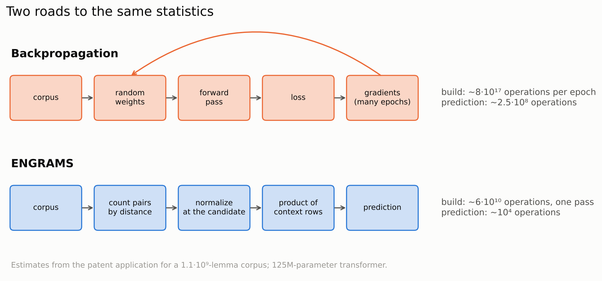
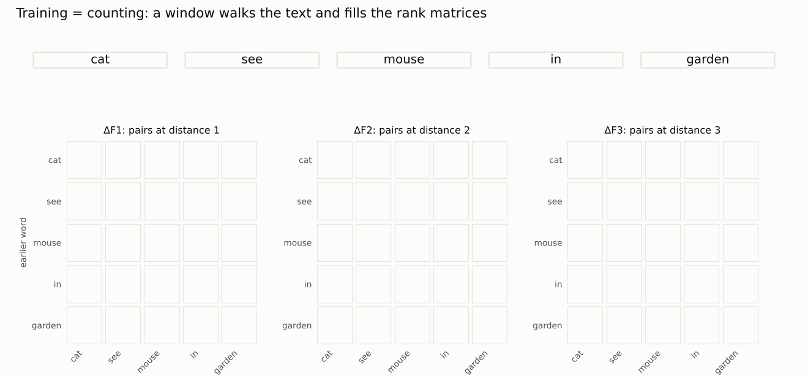
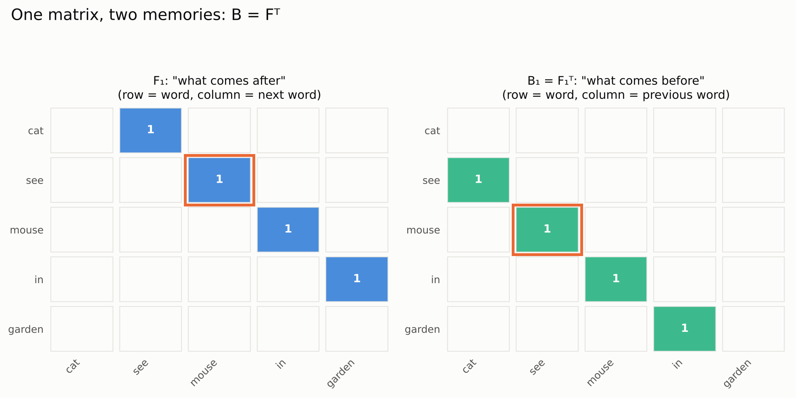
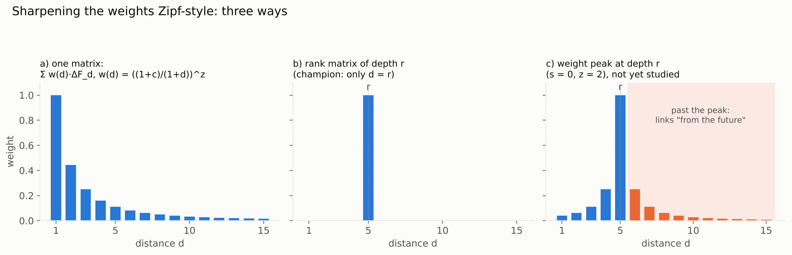
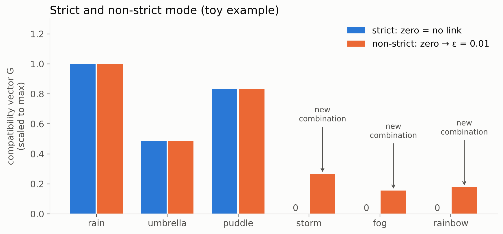
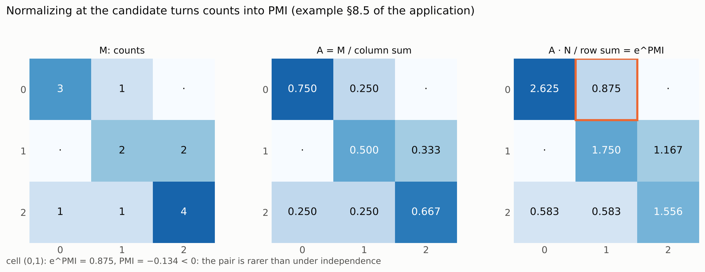
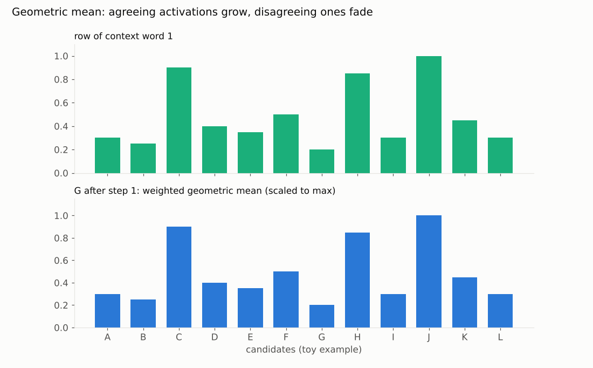
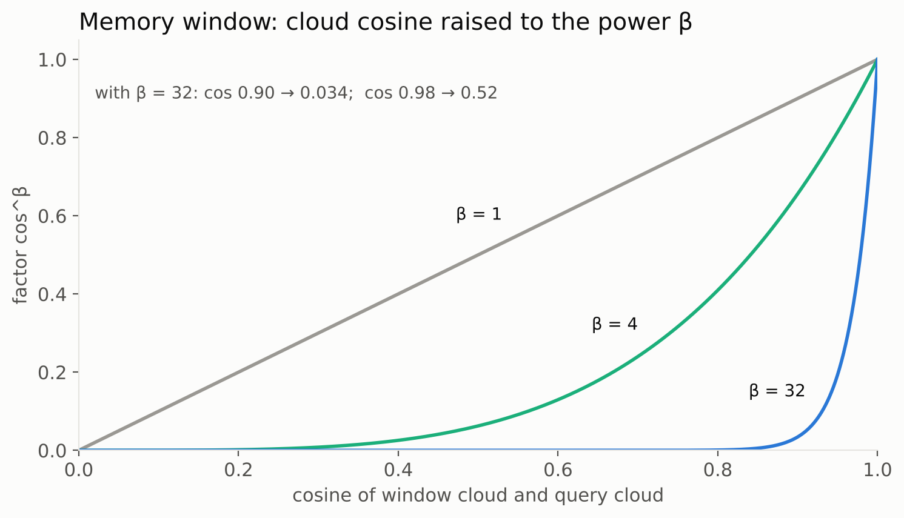
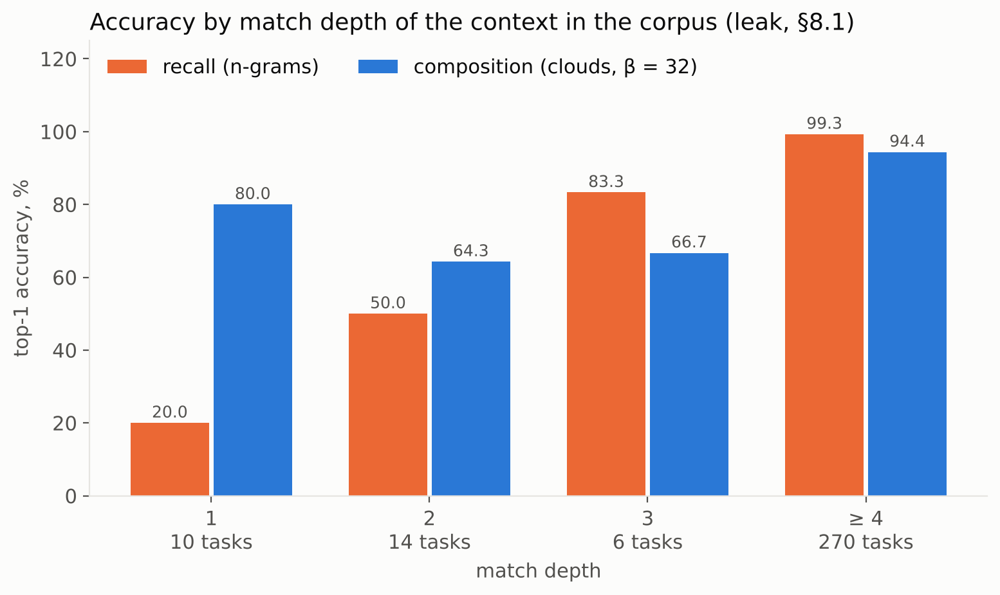
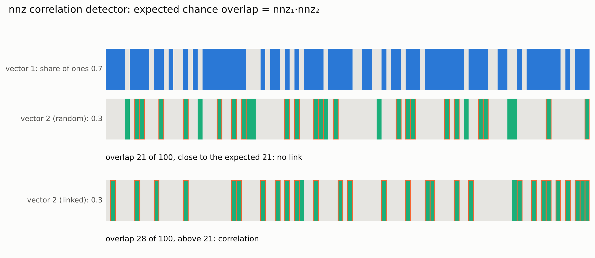

# ENGRAMS, part 1. Statistics instead of its approximation: a language model without backpropagation

*Series "ENGRAMS: sequence memory". Part 1 of 19, the overview. Code, figures and every number are in the repository under tag `part-01`.*

This article is a map of the whole series. It has no code and very few formulas. It has one job: to show how ENGRAMS differs in kind from the familiar neural networks trained by backpropagation, and why that difference opens doors that large models keep shut. Each section ends with a pointer to the part where the topic is covered in full, with code, measurements and the dead ends we walked into.

## 1. The core idea

A large language model is trained to predict the next token. Billions of weights are nudged by gradient descent until the model behaves like the tokens in the corpus. In effect, backpropagation **approximates the statistics of how tokens behave**. The statistics end up inside the model, but dissolved in the weights, where nobody can read them.

ENGRAMS takes the short road: **it uses the statistics themselves**. We pass over the corpus once, count which tokens occur at which distance from each other, normalize the counts, and that is it. There is no training in the gradient-descent sense. A prediction is assembled from rows of the count matrices with simple operations, and each operation can be traced back to concrete word pairs in the corpus.

The difference in cost is several orders of magnitude. Estimates for our corpus (about 1.1 billion lemmas of Russian Wikipedia, vocabulary of 100,005):

| | 125M-parameter transformer | ENGRAMS |
|---|---|---|
| building the model | about 8·10¹⁷ operations **per epoch** | about 6·10¹⁰ operations, **one pass** |
| one prediction | about 2.5·10⁸ operations | about 10⁴ operations |
| storing the window memory | full vectors: 1.46 TB | top coordinates only: 0.73 GB |

Everything in this series was computed on a single laptop.

## 2. The vocabulary is the feature space

In a neural network a token becomes a vector of a few thousand numbers, and nobody knows what any one of them means. In ENGRAMS **the rows and columns of every matrix are the tokens themselves**. The cell "cat × mouse" holds how many times *mouse* followed *cat* at a given distance. Nothing else.

Think of each token as a neuron and of each cell as the strength of a link between two neurons, and you get a network in which every neuron has a name. Three consequences follow.

**Full interpretability.** Every operation of the model (adding, multiplying, normalizing) acts on named rows and columns. Why did the model predict *mouse*? You can read it off: here are the rows of the context words, here is their product, here is the cell that won. Knowledge engineering becomes transparent. If you have a mental picture of how neurons ought to interact, you can carry it straight down to the level of matrices and test it the same day.

**A low hardware bar.** You do not need an accelerator cluster to study this model. The matrices are sparse and a prediction costs thousands of operations, not hundreds of millions. All the work on ENGRAMS was done on a laptop.

**Democratization.** Replacing gradient training, which approximates the statistics, with the statistics themselves cuts the computational cost by many orders of magnitude. That is a precondition for language-model research, and language-model inference, to stop being the privilege of large labs.

→ In depth: part 4 (lemmas as objects), part 7 (matrices), part 17 (the champion end to end).

## 3. Training is counting

### Rank matrices

A window walks along the text. For every pair of words at distance r we add one to a cell of the matrix ΔF_r: the row is the earlier word, the column the later one. ΔF₁ knows the neighbours, ΔF₂ the words one apart, and so on up to ΔF₁₅ in our champion.

A useful way to see a rank matrix is as a **residual connection between neurons with depth r**: it links a token not to its nearest neighbour but to the token r steps away. A model with R rank matrices is then a model of a neuron with R kinds of connections to other neurons, one per depth. The idea also has a hardware form. It is described in detail in Eurasian patent EA 044182 (claims 22–34): the memory is a crossbar of buses, one bus per object. Each crossing holds an artificial co-occurrence neuron: a counter that fires when a signal arrives on both buses at once and keeps the link separately for the forward and the backward direction. The matrix is symmetric, so half of it, a triangular "half-crossbar", is enough. Half-crossbars of different ranks are chained into sections, one section per distance: these are the rank matrices in hardware. The 2026 application includes the same scheme as claim 59, a device for the new methods. We have not tested this design in practice, and it may be of interest for neuromorphic and in-memory computing.

### B = Fᵀ: one matrix, two memories

Raw sequence-memory matrices have a simple and very useful property. F₁ answers "what comes after this word?". Its transpose answers "what comes before this word?". No second count is needed: **B = Fᵀ**.

This opens many possibilities inside the model: predicting the previous word as well as the next one, checking a hypothesis from both sides, building "past" and "future" clouds for the same position. One caveat: transposing swaps the order of row and column normalization, and that has to be accounted for.

### Sharpening the weights Zipf-style

The farther a word is, the less it should influence the prediction. We take a decay law similar to Zipf's law: the weight of distance d is proportional to ((1+c)/(1+d))^z. There are three ways to build it in.

1. **One matrix** that sums co-occurrences at all distances, each with its own Zipf weight. The simplest route, and where the project started.
2. **Rank matrices, each multiplied by its own weight.** A context word at distance r uses the matrix of exactly that distance. This is how the champion is built, and there the role of the Zipf weights is played by the exponents with which rows enter the product (section 6).
3. **Rank matrices with a weight peak at a chosen depth.** A word at distance r uses the sum of matrices for all distances, with weights falling off from r on both sides. The rows then carry **non-strict** weights: links lying "past the peak" leak in. That is not random noise and not residual links. These are links **from the future**, in other words backward links.

We have not studied the third way. It is in the patent claims, but there is not a single measurement of it. **We invite anyone interested to carry out this study.** Part 8 will provide a starter script and a measurement protocol.

→ In depth: part 7 (rank matrices and B = Fᵀ), part 8 (Zipf weights).

## 4. Strict and non-strict mode

In ENGRAMS a zero in a matrix means exactly one thing: **there is no Hebbian link**. These words never occurred together at this distance. The mistake we made most often was to replace zero with a small number ε "so the logarithm does not blow up". Then "no link" turns into "a weak link", and the model starts seeing co-activations that never happened in the corpus.

So the model has two modes.

- **Strict.** A candidate with no link to even one context word is out. The model is statistically sound: it proposes only what the corpus supports.
- **Non-strict (EPS).** A zero is given a small positive value. Behaviour shifts from strictly statistical to probabilistic. The model starts boosting combinations that never appeared in the corpus.

Non-strict mode is not a bug but a research instrument. It produces gross errors and genuine finds that the corpus does not contain, the kind of thing we call a hunch in people. It therefore needs filters that keep the good combinations and drop the nonsense. The patent application proposes two: assign a value only to candidates backed by words with a similar meaning, and output a prediction only above the independence threshold. Neither has been measured.

We know the price of careless substitution from a measurement: when the shared zeros were replaced by a constant of 0.01–0.1 while comparing clouds, the relative gap between "own" and "foreign" dropped from 13.8% to 0.3%. A constant in the shared zeros is the same for every pair and wipes out the differences.

The champion's numbers were obtained in strict mode, with one exception: the switching measurement (section 8) was made on a non-strict dump. Part 2 covers this rule ("rule 0") and how we measure in general.

→ In depth: part 2 (measurement rules), part 11 (the G vector).

## 5. Orthogonal normalization → PMI

Raw counts predict badly: frequent words (*and*, *in*, the comma) sit next to everything and win every vote. The usual fix is to normalize matrix rows, dividing by the mass of the context word. We normalize **columns** instead, that is, at the candidate: each cell is divided by the candidate's total count.

After that the cell "t × j" means the share of candidate j's occurrences that fall on context word t. A change that looks cosmetic has an exact meaning: the column-normalized cell multiplied by N/R_t is the **exponential of pointwise mutual information (PMI)**. PMI has an absolute zero: zero means the pair occurs exactly as often as it would under independence.

The figure shows the numeric example from the patent application. After normalization cell (0,1) gives e^PMI = 0.875, PMI = −0.134: the pair is rarer than under independence. In our form every weight is positive: we store e^PMI rather than PMI itself, and a pair that is rarer than under independence simply gets a weight below one. So nothing is cut off. The usual route is different: take PMI and zero out the negative values (PPMI). On language data that cutoff would remove 9–19% of pairs from every row, and the row intersection inside the product (section 6) needs those pairs.

In our measurement column normalization gave 86.17% top-1 accuracy against 73.40% for row normalization. And if you keep the normalized forms of both orders, PMI can be restored without the original counts, up to a single constant for the whole matrix. This was checked on four real matrices (256 million non-zeros) without a single order violation.

→ In depth: part 9 (normalization and PMI), part 10 (PMI without the counts).

## 6. Inference by geometric mean

How do we turn the rows of the context words into a prediction? We multiply them element-wise, with exponents:

G₁ = v₁, Gₖ = (Gₖ₋₁ · vₖ)^(1/pₖ), pₖ = a(n)·(k−1) + 1,

where vₖ is the row of the k-th context word and a(n) = 3.895 / (n − 2.633)^0.941 depends only on the context length n. The prediction is the candidate with the largest G. The product is taken only over candidates linked to every context word.

**Why geometric and not arithmetic.** The arithmetic mean is forgiving: a candidate strongly tied to one context word wins even if it has nothing to do with the rest. The geometric mean is not forgiving: it **amplifies agreeing activations and weakens disagreeing ones**. This is Hebb's rule at the level of prediction, "neurons that fire together wire together". A candidate wins only if all context words activate it at once. In the animation candidate J is strong in the first row, but its link in the second row is close to zero, and it fades. C and H are supported by every row and pull ahead.

The formula has several equivalent readings, each useful in its own way.

1. **A mean of logarithms, or a sum of PMI.** The logarithm of G is a weighted sum of the logarithms of the rows. After normalizing at the candidate, the log of a cell equals PMI minus a per-row constant, so the ranking of candidates matches the ranking by weighted sum of PMI with each context word.
2. **A logical AND.** A zero in any row kills the candidate, so the support of G is the intersection of the rows' supports. The candidate must be linked to the first word, and the second, and the third.
3. **A product of experts, or naive Bayes.** Each context word is an expert voting with P(word | candidate), which is exactly what normalizing at the candidate yields. Without a prior factor, frequent candidates get no head start.
4. **Log-linear interpolation of distance models.** Each rank matrix is a model of its own, and the exponents are the interpolation weights. The difference is that our exponents come from a single rule over the step number rather than being fitted per distance.
5. **Binding in vector symbolic architectures (VSA).** Element-wise product is the binding operation, and the geometric mean is binding that preserves scale. Channel post of 14.01.2025.
6. **Geometric activation.** The root of a product as a neuron's activation function, one that fires only when its inputs coincide. Channel post from 2025 (no later than 07.10.2025).
7. **Fading memory.** Unrolling the recursion, the nearest word enters with exponent 1/pₘ and each farther word with the product of all later divisors. That is exponential smoothing on a log scale: the past loses influence with every new word. Hence the link to the Zipf weights of section 3.

→ In depth: part 11.

## 7. Recall through clouds

Besides the matrices, the model has a window memory: for each position in the corpus it stores a vector of its left context and a "bag" of the words that came next. The champion holds 3,654,081 windows.

To recall a continuation we look for windows that resemble the query. Similarity is measured twice. First, by the dot product of the G vectors of the window and the query: how well the exact context matches. Second, by the cosine of their **clouds**. A cloud is the sum of matrix rows over all distances for the words in the past, a semantic field around the position. The cloud cosine is raised to the power β = 32, which sharply cuts windows with similar words but a different topic.

The prediction is the sum of the continuation bags of the best windows, weighted by their scores. This is **composition**: the model assembles its answer from similar but non-identical contexts and can predict something that never occurred in that context. In our measurement composition reached 92.00% top-1 accuracy, and 100% on content words.

→ In depth: part 12 (clouds), part 13 (window memory), part 14 (recall through clouds).

## 8. Recall through n-grams, and switching

The second way to remember is to find places in memory where the last words of the context match the corpus verbatim, and let the words that followed there vote. The **match depth** is how many of the last words match in a row.

The two heads shine in different places. When the match is deep, verbatim recall almost never errs. When it is shallow, composition does better.

Hence a simple rule: if the depth is at least a threshold h₀, output recall, otherwise composition. Depth is a continuous marker available on every task before any prediction is made. Switching reached 98.67% against 92.00% for the best fixed blend of the two heads: 10 tasks won, 0 lost, p = 0.002 (150 report tasks, non-strict dump). Composition is computed on only 8% of positions.

→ In depth: part 15 (n-grams), part 16 (switching).

## 9. The nnz correlation detector

One more simple idea (the observation was first made by Alexey Tarasov on his channel). Take two binary vectors whose shares of ones are 0.7 and 0.3. If they are independent, their ones coincide by chance in about 0.7 · 0.3 = 0.21 of positions. Noticeably more coincidences means the vectors are linked; fewer means they repel.

The generalization from binary weights to a continuous weight function was done in ENGRAMS, for our case of vectors whose weights are much smaller than one. For L1-normalized vectors the expected dot product under independence is 1/N_V. For L2-normalized vectors it is √(nnz_X · nnz_Y)/N_V. The generalization made it into the patent application as a threshold for memory windows and for checking that a verbatim match also matches in meaning. **The champion does not use it, and it has not been measured**, so this is another open direction.

→ In depth: part 19.

## 10. What has already been tested

Every part of the series will have this section. It collects the experiments on the part's topics: first the ones that worked, then the ones that did not, with numbers from the working reports. The goal is simple: not to waste your time on what has already been done. If you repeat an experiment, do it to check it, not to discover it.

How to read the numbers. Almost everywhere they are **top-1 accuracy** (@1): the share of tasks where the correct word comes first. **Leak** means the task's own window is in memory, so the test measures recognition. **Gen** means the task's neighbourhood of ±30 positions is cut out of memory, so the test measures generalization. "Content words" are tasks where the target is a meaningful word rather than a preposition or a comma. Part 2 covers measurement in detail.

### What worked

| what was tested | result | setup | details |
|---|---|---|---|
| Zipf exponent z in a single matrix, weights 1/(d+1)^z | of z = 0.1, 0.5, 5 and 10, **z = 5** was best. At z = 0.1 and 0.5 accuracy drops roughly by half, at z = 10 by 2–3 %. The reports we found keep only these estimates, not a table per z | BPE, 32,041 tokens; trained on 200–400 MB of Wikipedia; 1,000 held-out positions | part 8 |
| Geometric mean with an exponent that depends on context length | @1 from 15.0 % (context 3) to 19.3 % (context 1,000), top-10 about 46 %. The best exponent falls with length as a hyperbola; of four fits the hyperbola is the most accurate (RMSE 0.11 against 0.34–4.39) | same setup, 12 context lengths | part 11 |
| Column normalization (at the candidate) against row normalization | **86.17 % against 73.40 %** | vector G in window memory, leak, content words, length 15 | part 9 |
| Double normalization: columns first, then rows | on gen, column-only lost to row-only (33.77 % against 35.71 %); double normalization was adopted as the best | gen | part 9 |
| Strict against non-strict mode (the G channel of window memory) | strict is never worse and is better at four of seven comparison points; without the cloud factor **74.31 % against 70.14 %**. Support of G: a median of 133–136 candidates in strict mode against 25,105 in non-strict | leak, 144 content-word tasks | parts 2, 11 |
| Cloud cosine raised to the power β | going from β = 0 to β = 32 raised accuracy from 74.31 % to **100 %** on leak, and by 3.47 points on gen | 144 tasks (leak) | part 14 |
| Switching by match depth | **98.67 % against 92.00 %**, 10 tasks won, 0 lost, p = 0.002 | 150 report tasks, non-strict dump | part 16 |
| Matching the query to memory | same context boundary: 53.87 % against 22.54 %; same rank limit (15 and 15): 53.52 % against 41.55 % | leak, 284 tasks | part 13 |
| Zipf weights in the continuation bag (where argmax is taken) | **46.83 % against 10.92 %** with linear weights | leak, 284 tasks | part 13 |
| Linear weights in the selection bag (where cosine is computed) | **52.82 %** against 43.31 % for a binary bag and 3.52 % for a Zipf-weighted bag | leak, 284 tasks | part 12 |
| Masking the unknown word [UNK] | +3 points in every configuration | leak, 284 tasks | part 4 |

The last two rows gave a rule worth remembering: **Zipf weights where argmax is taken; linear weights where cosine is computed.** Zipf weighting squeezes a vector down to the two or three nearest words, and the cosine between such vectors stops meaning anything.

### What did not work

| what was tested | result | setup | details |
|---|---|---|---|
| Rank matrices on a small corpus | failure: −22 % on top-10. The matrices are 0.6–1.1 % full against 25 % for a single matrix, and the product runs out of shared non-zeros. On the full corpus (1.1 billion lemmas) rank matrices became the basis of the champion | 200–400 MB of text | part 7 |
| Extra Zipf weights on top of rank matrices | steady decline: z = 0 → 41.55 %, 0.5 → 40.85, 1 → 36.62, 2 → 26.06, 3 → 23.24, 5 → 20.77. The exponents of the G recursion already provide the decay; a second decay switches off everything beyond the second word, and G degenerates into a bigram | leak, 284 tasks | part 8 |
| Reweighting rows before the product: percentile gating, adaptive gating, contrast enhancement, softmax and temperature softmax, LayerNorm + ReLU | none helped: from 0 to +0.3 points at best, from −5 to −22 at worst | BPE, 1,000 positions | part 11 |
| PVS normalization (σ = 1 and σ = 1500) instead of L2 | identical to L2 | BPE, 1,000 positions | part 9 |
| A constant exponent α instead of a(n) | 13.20 % against 13.47 % (top-100: 62.67 % against 62.93 %), practically no difference. The variant stays in the claims but brings no gain | lemmas, single matrix, context 30, 750 positions | part 11 |
| Products of the matrices F, B, Fᵀ, Bᵀ (all 16 pairs) | the best, Bᵀ·B, gives 5 % against 19 % for F itself. Fᵀ·F is a word-similarity matrix, not a transition matrix, and does not inherit the predictive power of F | BPE | part 9 |
| A cloud instead of vector G for finding windows | 26.16 % against 48.55 % at top-1. But the correct answer is in the top-10 in 93.9 % of cases, so clouds became the first, cheap selection stage | leak, 344 tasks | part 12 |
| A query cloud built from vector G rather than from summed cloud rows | 2.62 % against 26.16 %: the query and the windows must live in the same space | leak, 344 tasks | part 12 |
| Column normalization in the selection cosine and in the cloud factor | does not help; it works only inside the G product. Even there the gain is on leak only (70.21 → 80.85 %); on gen there is none, the changes are fractions of a percent, at noise level | leak and gen | part 9 |
| Replacing shared zeros with a constant of 0.01–0.1 when comparing clouds | the relative own-versus-other gap fell from 13.8 % to 0.3 % | cloud comparison | parts 4, 12 |
| Splitting word vectors into a "function-word basis" and a meaning part, v = √(d·s) | did not work: function words do not form a common basis. Prepositions are barely similar to one another (within-group similarity 0.08–0.12) | clustering of function words | part 18 |

### What has not been measured

The Zipf peak at a chosen depth, filters for non-strict mode, the nnz correlation detector and the power A^α @ B^α in matrix products all remain unmeasured. The reports also contain no direct comparison of the geometric and arithmetic mean on one setup: the failure of every attempt to reweight rows (table above) argues for the geometric mean, but there is no separate "geometric against arithmetic" table. These are good tasks for anyone who wants to join.

## 11. What comes next

The model is built, tested and described. Many directions are only sketched, and we would like more people than us to take them up.

- **A Zipf weight peak at a chosen depth**: links "from the future" (section 3).
- **Filters for non-strict mode**: how to keep the finds and drop the nonsense (section 4).
- **The nnz correlation detector** for window selection (section 9).
- **√A @ √B instead of A @ B**, and more broadly the power A^α @ B^α when multiplying co-occurrence matrices. With rows that are distributions, √A @ √Aᵀ gives the Bhattacharyya coefficient and the Hellinger metric. Not studied.
- **More memory.** The window memory now covers two fragments of the corpus out of 584, about 0.7%. In gen mode, where the task's neighbourhood is excluded from memory, this is the main limit: composition reaches 26.00% and recall 33.67%. Eight fragments instead of two raised the best gen accuracy from 34.00% to 41.33%.

## How to read the series

| block | parts |
|---|---|
| The picture and the rules | 1, overview; 2, how we measure |
| Data and objects | 3, corpus; 4, lemmas; 5, why not BPE or syllables; 6, segments and pairs |
| Training is counting | 7, rank matrices and B = Fᵀ; 8, Zipf weights; 9, normalization and PMI; 10, PMI without counts |
| Inference | 11, geometric mean; 12, clouds; 13, window memory; 14, recall through clouds; 15, n-grams; 16, switching; 17, the champion end to end |
| Vocabulary and what's next | 18, general vocabulary vs names; 19, results and open directions |

Each part will come with runnable code, numbers that state what produced them and on what data, and an account of the approaches that did not work.

---

*All numbers come from the patent application (filed 21.11.2026) and the project reports; figures 1, 6 and 9 show real data, the rest are toy examples. The figures are rebuilt by `docs/figures/make_part01_figures.py`. Code is under PolyForm Noncommercial 1.0.0: free for research, education and other non-commercial purposes; commercial use requires a license from the author (see `COMMERCIAL.md`). Author's channel (in Russian): [t.me/sequence_memory](https://t.me/sequence_memory).*
