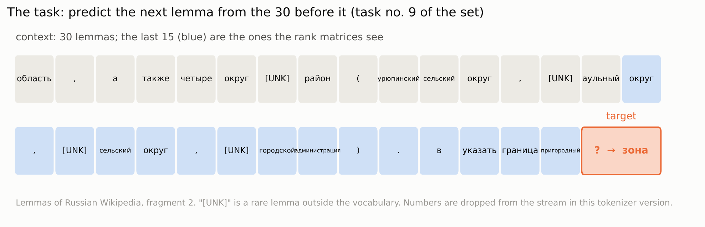
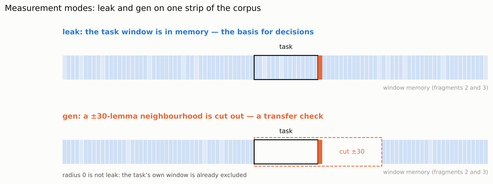
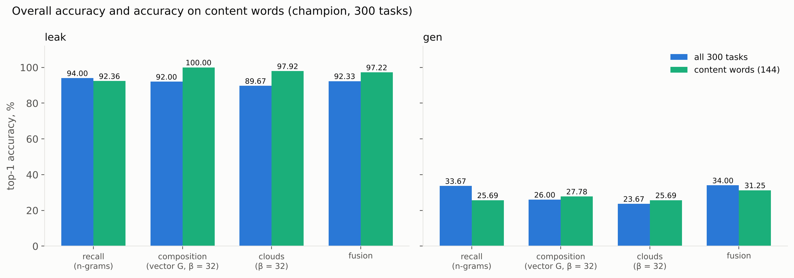
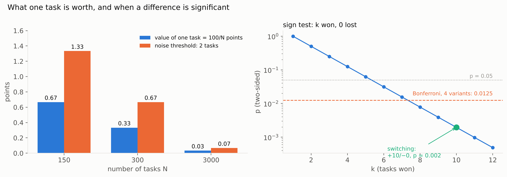

# ENGRAMS, part 2. How we measure: tasks, leak and gen modes, noise and the zero rule

*Series "ENGRAMS: sequence memory". Part 2 of 19. Code, figures and every number are in the repository under tag `part-02`.*

> ## 🤝 Why we are opening this work
>
> **The goal of publishing it is to build a community: a group of people who are interested in this work and would like to join the project.** The code, the results and the open questions are published so that they can be checked, developed and explored together. If you are interested, write in the discussion group [t.me/sequence_memory](https://t.me/sequence_memory) or open an issue in this repository. The series is published in the channel [t.me/E_N_G_R_A_M_S](https://t.me/E_N_G_R_A_M_S); discussion happens in the group @sequence_memory linked to it. This keeps the parts of the series in order in the channel instead of mixed with questions and comments.

A number in this series means something only if you know how it was obtained. The most expensive mistakes of the project were mistakes of measurement, not of the model: numbers without a mode label, results compared across different task sets, measuring something other than what was intended. This part describes how a measurement is set up and which rule appeared after each such mistake. All later parts rely on it.

## 1. The task

The model gets 30 consecutive lemmas and must predict the next one. For example, task no. 9 of our set:

The correct answer is «зона» ("zone": «в указанных границах пригородной зоны», "within the specified boundaries of the suburban zone"). The correct lemma in first place counts; in second place it does not. The metric is **top-1 accuracy** (@1): the share of tasks where the correct lemma comes first.

The task set was built as follows:

- **Source**: fragment 2 of the 584 fragments of the Russian Wikipedia (1,815,018 lemmas). These are the same lemmas the model is built from (part 4).
- **Positions**: 3000 random places in the fragment. The first 500 were drawn with seed 42; the other 2500 were added with seed 4242 so that the old tasks stayed the same, under the same numbers. Otherwise numbers from old runs would no longer be comparable with new ones.
- **Target filter**: we keep tasks whose target is among the 1000 most frequent lemmas of the corpus. 2820 tasks of 3000 pass. This restriction should be kept in mind: the numbers in this series describe prediction of frequent vocabulary; rare lemmas are not measured.
- **Size**: the first 300 tasks that pass the filter. This is the working size of all measurements in the series; where conclusions were rechecked on more tasks, it is stated.

The set is in the repository: `data/tasks/`. Next to it is a script that selects these 300 tasks from it and prints their composition.

Lemmas in this tokenizer version are alphabetic tokens. Punctuation marks are full objects and have to be predicted too. Numbers are dropped from the stream, and rare lemmas outside the vocabulary are replaced with `[UNK]`, 5.13 % of the stream. Details in part 4.

## 2. Two modes: leak and gen

An ENGRAMS model is co-occurrence matrices plus a **window memory**: for every corpus position it stores the context and what came next. The memory is the trained model. So a "held-out test" in the usual sense means something different here, and there are two measurement modes.

- **Leak.** The task's window is in memory. This is the **main mode**: all decisions are made on it. It answers whether the model can find and use what it knows. Excluding the memory from the measurement makes no sense: without statistics the model is like Mowgli without language.
- **Gen** (generalisation). A ±30-lemma neighbourhood of the task is cut out of memory. This is the **control**: it shows what the model does in an unfamiliar place and watches the transferability of the part of the model that rests only on the matrices. Growth on gen is a sign that an improvement is not just recognition.

**Every number in the series is labelled with its mode.** A number without a mode is invalid. Section 8 tells why this rule became mandatory.

There is also a trap. Windows are excluded by the filter "distance to the task is **greater** than the radius". At radius 0 the task's own window is already excluded. So radius 0 is not leak but an intermediate mode that measures nothing in particular. Leak is radius −1 only, when nothing is excluded.

## 3. Content and function targets

Of the 300 tasks, 144 have a content word as the target and 156 a function word: a punctuation mark or a word from a short list of function words: prepositions, conjunctions, pronouns, particles, the verbs «быть», «мочь», «стать», «являться» (be, can, become, be/serve as) and a few adverbs like «уже» and «ещё» (already, still). The list is in the task selection script. Overall accuracy says more about function words than about meaning.

So we report both cuts. The figure shows why. Composition via the G vector on leak gives 92.00 % overall and **100 %** on content words. Recall by n-grams, on the contrary, is weaker on content words (92.36 %) than on average (94.00 %). A single overall number does not show this difference, and the choice between the mechanisms would have been made wrongly.

## 4. Noise: what one task is worth

One task is worth 100/N percentage points. On 300 tasks that is 0.33 points, on 150 it is 0.67. **A gain of less than two tasks cannot be told apart from noise**, and we do not count it.

**Decisions follow three rules.**

1. **The criterion is declared before the measurement.** Before the run we write down what counts as success and why the threshold is above noise. The criterion cannot be fitted to the number obtained.
2. **Variants are compared by a sign test.** We look only at the tasks where two variants disagree: how many one won and how many the other. If several variants were tried, the significance threshold is divided by their number (Bonferroni correction).
3. **Tuning and reporting on different halves.** If a method has a threshold, it is tuned on one half of the tasks and the result is reported on the other.

An example is the switch between recall and composition from part 1. The 300-task set is split in half. The depth threshold was tuned on the first half. Four marker variants were tried, so the significance threshold is 0.05 / 4 = 0.0125. On the second, report half (150 tasks) the switch gave 98.67 % against 92.00 % for a fixed blend of the two heads: 10 tasks won, 0 lost, p = 0.002. This is below 0.0125, so the result was accepted.

## 5. Compare like with like

Two numbers are compared only if they share the memory, the task set, the context length, the normalisation and the mode. Numbers taken on different task sets are never compared, even if the difference looks convincing.

The same rule covers **matching the query and the memory**. The G vector is computed in two places: when building the window memory and when processing the query. If the formula is changed in one place and forgotten in the other, the memory is built with one formula and the query with another, and the measurement shows garbage. The same goes for the window step, context length, rank limit and minimum context. The measurement script prints the G mode of the query and of the memory and explicitly confirms that they match.

We know the cost of a mismatch from measurements (part 13): a different context boundary in query and memory gives 22.54 % instead of 53.87 %; a different rank limit (60 in memory, 15 in the query) gives 41.55 % instead of 53.52 %.

## 6. Rule 0: zero is not a small number

In ENGRAMS strict mode, a zero in a matrix means **there is no Hebbian link**. Replacing zero with a small number (`+1e-10`, `max(x, tiny)`, "so that the log does not fail") turns "no link" into "a weak link" and creates joint activations that never occurred in the corpus. This changes both the set of candidates and their order.

So the measurement code contains no such substitution. Instead:

| situation | instead of substitution |
|---|---|
| zero under a logarithm | the coordinate does not take part (−∞ on the log scale) |
| zero in a denominator | the element is excluded, and this is logged |
| zero vector norm | the vector is excluded from candidates, and this is logged |

How does this fit with the non-strict mode from part 1? Non-strict mode is an **explicit research decision**, not an accidental "safeguard" in the code. It is switched on separately, its numbers are always labelled non-strict, and it is never mixed with strict measurements. The only champion number taken on a non-strict-mode dump is the switch measurement, and this is stated next to it.

## 7. Reproducibility

Three simple rules that saved the most time.

- **A copy of the script next to the data.** Every script puts a copy of itself and a `meta.json` file into the folder of the data it created. Opening the folder shows at once what built it. The copy is never edited after the fact, even if a mistake is found in it: the mistake is described in `meta.json` and in the report.
- **Nothing is deleted irreversibly.** What is no longer needed goes to quarantine and is deleted only after a check.
- **One run, one self-contained cell.** A Jupyter cell contains all paths, parameters and commands of one step and runs on its own. Long passes can resume from where they stopped.

The full text of the project rules is in `docs/RULES.en.md` (Russian version: `docs/RULES.ru.md`).

## 8. What has been tested

As in every part, this section collects the checks on the topic: first what worked, then the mistakes, then what has not been measured. In this part these are mistakes of the measurement itself. All of them really happened, and each cost days of work.

### What worked

| what was tested | result | conditions | details |
|---|---|---|---|
| Switch, threshold tuned on half the tasks, reported on the other | 98.67 % vs 92.00 %, +10/−0, p = 0.002 at threshold 0.0125 (4 variants) | leak, 150 report tasks, non-strict-mode dump | part 16 |
| Splitting targets into content and function words | showed that overall accuracy mostly describes function words: in one series, 190 function targets vs 94 content targets, and the old champion's "superiority" (74.65 % vs 65.14 %) came entirely from function words (75.79 % vs 61.05 %); on content words the new variant was better (73.40 % vs 72.34 %) | leak, 284 tasks | part 13 |
| Masking `[UNK]` in counting | +3 points in all configurations, became a mandatory setting | leak, 284 tasks | part 4 |
| Matching query and memory | context boundary: 53.87 % vs 22.54 %; rank limit: 53.52 % vs 41.55 % | leak, 284 tasks | part 13 |

### What did not work: measurement mistakes

| mistake | what happened | the rule that grew out of it |
|---|---|---|
| Numbers without a mode label | a series of measurements showed 24–33 % instead of the reference 68 %, and this was taken for a degradation of the mechanism. In fact the new numbers were taken on gen and the reference on leak. On leak the same mechanism gave 92–100 % | every number carries its mode (section 2) |
| Exclusion radius 0 | a radius-0 run was called leak mode and time was spent on it. At radius 0 the task's own window is already excluded, so it is not leak | leak is radius −1 only (section 2) |
| Different task sets | the head blend was measured on 1164 tasks, the switch on 582. The difference of 24.40 % vs 25.26 % turned out to be an artefact of the different sets | compare only on one set (section 5) |
| Criterion after the measurement | conclusions about the "best" setting were drawn from the overall number without a pre-declared threshold, and some had to be withdrawn after the target split | criterion before measurement, sign test, Bonferroni (section 4) |
| Replacing zero with a small number | when comparing clouds, shared zeros were replaced with a constant of 0.01–0.1; the relative gap "own vs other" fell from 13.8 % to 0.3 % | rule 0 (section 6) |
| Cross-domain set | the script that built tasks for other domains (legal texts, prose, poetry) tokenized the text in the wrong order. Numbers for other domains obtained before the fix need rechecking, and we do not report them in the series | check a task set against the source stream |

### What has not been measured

- **Comparison with large language models on a common task.** Our metric is our own; the model has not been compared on standard LLM benchmarks. There are only estimates of computational cost (part 1).
- **Spread over random task sets.** All numbers come from one set. How much they change on another random set from the same fragment has not been measured.
- **Rare vocabulary.** The filter by the 1000 most frequent lemmas leaves it outside the measurement.
- **Familiarity with the domain.** There is an idea to measure it from the context itself, without annotation, but it is not implemented.

These are good tasks for anyone who wants to join.

## 9. What comes next

The next block of the series is data and objects: the corpus (part 3), lemmas (part 4), why not BPE or syllables (part 5), segments and pairs (part 6).

---

*Numbers come from the project reports and the patent application (filed 21.11.2026). Fig. 1 is a real task from the set, fig. 4 shows the champion's numbers, figs. 2 and 3 are diagrams. The figures are rebuilt by `docs/figures/make_part02_figures.py`. Code is under PolyForm Noncommercial 1.0.0: free for research, education and other non-commercial purposes; commercial use requires a license from the author (see `COMMERCIAL.md`). Publications: channel [t.me/E_N_G_R_A_M_S](https://t.me/E_N_G_R_A_M_S); discussion: group [t.me/sequence_memory](https://t.me/sequence_memory) (both in Russian).*
