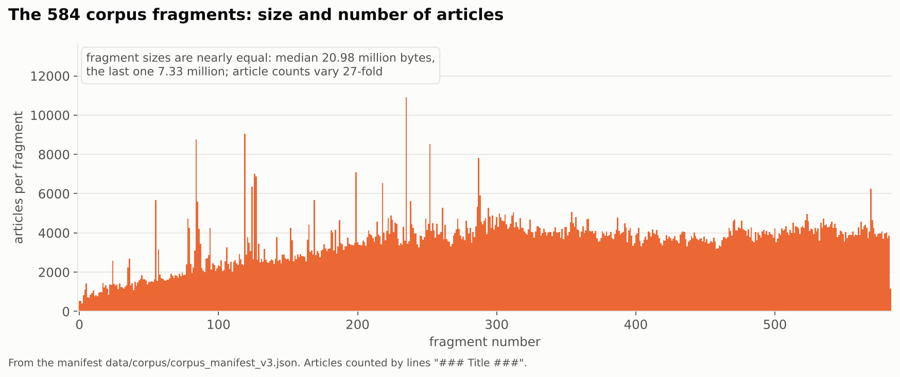
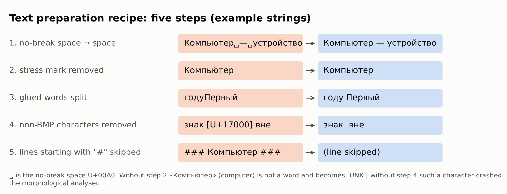
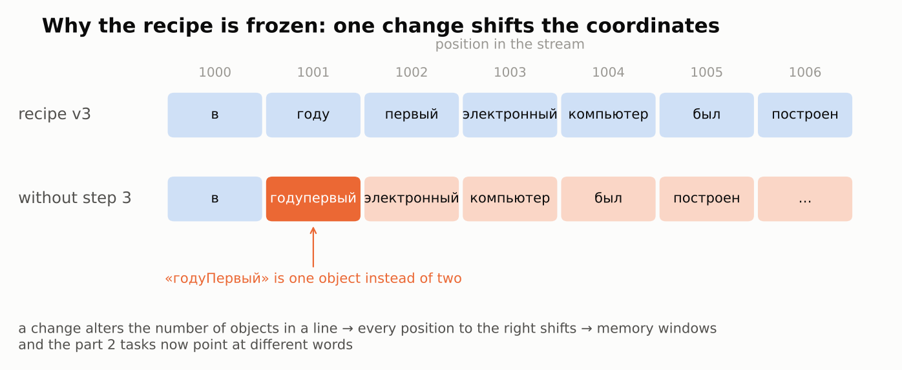

# ENGRAMS, part 3. The corpus: where the text comes from and why the preparation recipe must not change

*Series "ENGRAMS: sequence memory". Part 3 of 19. Code, figures and every number are in the repository under tag `part-03`.*

> ## 🤝 Why we are opening this work
>
> **The goal of publishing it is to build a community: a group of people who are interested in this work and would like to join the project.** The code, the results and the open questions are published so that they can be checked, developed and explored together. If you are interested, write in the discussion group [t.me/sequence_memory](https://t.me/sequence_memory) or open an issue in this repository. The series is published in the channel [t.me/E_N_G_R_A_M_S](https://t.me/E_N_G_R_A_M_S); discussion happens in the group @sequence_memory linked to it. This keeps the parts of the series in order in the channel instead of mixed with questions and comments.


An ENGRAMS model is corpus statistics. Everything it knows it knows from text, and every prediction can be traced back to specific places in that text. So the corpus here is not "training data" that could be swapped for something similar: it is the model in raw form. This part describes where the text comes from, how it is prepared and why the preparation recipe is frozen.

## 1. Where the text comes from

The corpus is the Russian Wikipedia. The source is the official dump `ruwiki-latest-pages-articles.xml.bz2` from dumps.wikimedia.org, i.e. the latest dump at the time of download. The dump was downloaded on 29.12.2025: the file `ruwiki-dump.xml.bz2` (5.79 GB) was created at 12:33 and finished at 12:59 that day. The script downloads the `latest` link, so the release date is not in the file name; it was recovered from the content: the latest edit in the dump is dated 21.12.2025 14:26 UTC. So this is the December 2025 release, with articles as of 21.12.2025.

The 584 fragments of the series were cut from this dump the same day: the first fragment was created at 13:57. Earlier cuts (autumn 2025) were made from a different, "dirty" text and did not go into v3.

The build is done by `scripts/part03/download_wiki_ru.py`:

- only articles (namespace 0) and only the latest revision of each are taken;
- wiki markup is stripped by the mwparserfromhell library (`strip_code`): links keep their visible text, and category links keep their name;
- articles shorter than 100 characters are skipped;
- each article is written as `### Title ###`, a blank line and the text;
- the text is cut into 20 MiB fragments: a new fragment starts as soon as the current one reaches that size.

The result is **584 fragments** totalling 12,240,801,052 bytes (11.4 GiB). The fragments are nearly equal in size: median 20.98 million bytes (the 20 MiB threshold plus the tail of the last article), the last one 7.33 million. Articles end with `Категория:…` (Category) lines: a category link becomes plain text once the markup is stripped. Counting title lines gives **2,076,119 articles**, from 400 to 10,909 per fragment.



The article count varies 27-fold at nearly equal size, so in the first fragments articles are on average much longer. Articles follow the dump order; why long articles come first in it we did not check; what matters for measurement is that the part 2 tasks come from fragment 2, which has only 400 articles, i.e. long encyclopaedic texts.

Wikipedia text is licensed under CC BY-SA 4.0. The fragment manifest (name, size, md5, article count, first title) is in `data/corpus/corpus_manifest_v3.json`. With the md5 sums anyone who rebuilds the corpus can check that they got the same files. The ready fragments are downloaded into a clone with `python scripts/fetch_data.py --what corpus` (from Hugging Face) and checked against the manifest with `python scripts/part03/check_manifest.py`; paths and run order: [`docs/DATA_PATHS.md`](../../DATA_PATHS.md).

## 2. Preparation: five steps

Before lemmatisation every line goes through the same recipe:



```python
text = text.replace('\xa0', ' ')                          # 1. no-break space
text = text.replace('́', '')                         # 2. stress mark
text = re.sub(r'([а-яёa-z])([А-ЯЁA-Z])', r'\1 \2', text)  # 3. glued words
text = ''.join(c for c in text if ord(c) < 0x10000)       # 4. non-BMP characters
# 5. line by line; lines starting with '#' are skipped
```

Each step fixes a specific breakage.

1. **No-break space.** Wikipedia puts it between a number and its unit, before a dash, inside initials. After replacement it is an ordinary space, and word splitting works the same for both kinds of space.
2. **Stress mark.** Russian Wikipedia marks stress in the first line of an article: «Компью́тер». The mark U+0301 is a separate character, and a word containing it is no longer alphabetic: it goes to `[UNK]`, and in the most important place of the article, the definition.
3. **Glued words.** The exported text contains joins like «годуПервый». A lowercase letter immediately followed by an uppercase one almost never occurs inside a Russian or Latin word, so the text is cut there.
4. **Non-BMP characters.** Rare characters with codes from 0x10000 (ancient scripts, rare ideographs, emoji) crashed the morphological analyser. They are rare, but one is enough to stop a pass that takes hours.
5. **Lines starting with `#`** are article titles. They do not enter the lemma stream.

The recipe code with examples is `scripts/part03/preprocess_v3.py` (run with `--demo` to see each step).

## 3. Why the recipe is frozen

After preparation the text becomes a stream of objects, lemmas and punctuation marks (part 4). Every object has a **coordinate**: the fragment number and the position in the stream. Everything else rests on these coordinates: memory windows (part 13), the task set (part 2), sentence boundaries.



Any change to the recipe alters the number of objects in at least one line. For example, without step 3 «годуПервый» is one object instead of two. Then every position to the right shifts, and memory windows and tasks point at different words. No error is raised: the numbers simply become wrong.

Hence the rule: **the recipe changes only together with a full rebuild of everything that depends on it, and under a new version name**. In v3 the recipe was deliberately kept unchanged although the tokenizer changed: "preprocessing recipe not changed (otherwise the coordinates would drift)".

## 4. What came out

| quantity | value |
|---|---|
| objects in the stream (lemmas, marks, `[UNK]`) | 1,080,086,644 |
| sentences | 85,527,922 (≈ 12.6 objects per sentence) |
| fragments whose lemma and morphology streams match in length | 584 of 584 |
| objects in fragment 2 (part 2 tasks) | 1,815,018 |
| time: lemma dictionary / streams | 7 h 22 min / 7 h 50 min (6 processes) |

How lines become lemmas, why numbers drop out of the stream and where the 5.13 % of `[UNK]` comes from: part 4.

## 5. What has been tested

### What worked

| what was tested | result | conditions | details |
|---|---|---|---|
| Rebuilding the whole pipeline with fixed preparation (steps 2 and 4, no `lower()`; at the same time punctuation became objects and the dictionary was fixed, see below) | top-1 accuracy 13.20 % vs 8.13 % on the broken data | an old measurement before the series; mode and number of tasks not stated in the report; the effect is shared by all fixes at once, the contribution of preparation alone was not measured | — |

### What did not work: mistakes

| mistake | what happened | what grew out of it |
|---|---|---|
| `lower()` before the lemmatiser | all text was lowercased before parsing. The lemmatiser lost the capital-letter cue, and lemmas came out wrong | case is not touched before lemmatisation |
| Stress marks not removed | «Компью́тер» was not a word and went to `[UNK]`, in the first, defining line of the article | step 2 |
| No BMP filter | a non-BMP character crashed the morphological analyser mid-pass | step 4 |
| Two dictionaries out of sync | the "id → lemma" file and the "lemma → id" file diverged: `lemma2id['компьютер'] = 2476`, but `id2lemma[2476] = 'наблюдать'` (to observe). Counting was correct, but every lemma shown in the reports was random | one dictionary is the source of truth, the other is built from it |
| Filter changed mid-pass | in one measurement of the next version's dictionary the character filter changed at fragment 245 of 584: ideographs, Arabic and Hebrew script were counted in the first 42 % of the corpus and cut out in the rest. For these scripts the numbers are about 2.4 times too low | the mix was allowed manually to save 4 hours, and its cost was named only later. Rule 13 requires that a pass does not continue when parameters change; this check must not be bypassed |

### What has not been measured

- **The effect of the domain.** The whole corpus is an encyclopaedia. There was a measurement on other genres, but with a bug in building the tasks (part 2), so there is no answer yet.
- **Category lines.** The recipe skips only titles, so `Категория:…` lines enter the stream. What share of the stream they take and how they affect prediction has not been measured.
- **Duplicates and template articles** (look-alike articles about settlements, species, years). Their share has not been measured.
- **The number of articles.** Counting title lines gives 2,076,119; one working report records 2,087,814. The difference of 11,695 articles has not been examined.

These are good tasks for anyone who wants to join.

## 6. What comes next

Part 4: lemmas as objects: tokenizer v3, a vocabulary of 100,005 items and why numbers drop out of the stream.

---

*Numbers come from the project reports and the fragment manifest. Fig. 2 shows real data, figs. 1 and 3 are example strings and a diagram. The figures are rebuilt by `docs/figures/make_part03_figures.py`. Code is under PolyForm Noncommercial 1.0.0: free for research, education and other non-commercial purposes; commercial use requires a license from the author (see `COMMERCIAL.md`). Wikipedia text is CC BY-SA 4.0. Publications: channel [t.me/E_N_G_R_A_M_S](https://t.me/E_N_G_R_A_M_S); discussion: group [t.me/sequence_memory](https://t.me/sequence_memory) (both in Russian).*
