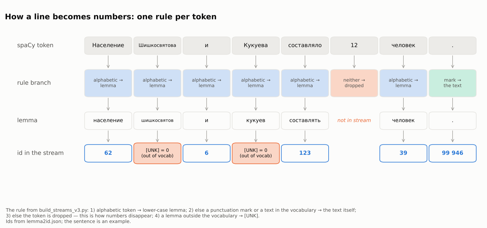
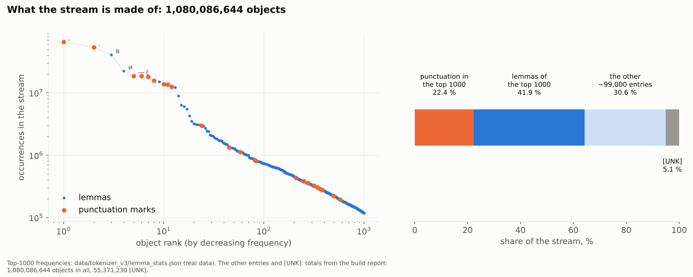
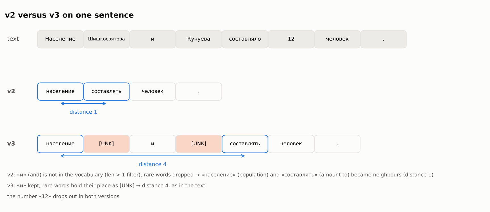

# ENGRAMS, part 4. Lemmas as objects: tokenizer v3

*Series "ENGRAMS: sequence memory". Part 4 of 19. Code, vocabulary, figures and all numbers are in the repository, tag `part-04`.*

> ## 🤝 Why we are opening this work
>
> **The goal of this publication is to build a community: a group of people who find this work interesting and would like to join the project.** The code, results and open questions are published so that they can be checked, developed and explored together. If you are interested, write in the discussion group [t.me/sequence_memory](https://t.me/sequence_memory) or open an issue in this repository. The parts of the series are published in the channel [t.me/E_N_G_R_A_M_S](https://t.me/E_N_G_R_A_M_S); discussion takes place in the group @sequence_memory linked to the channel. This way the parts follow each other in the channel and do not get lost among questions and comments.


In part 3 the corpus became 584 fragments of prepared text. The model does not work with text but with a stream of ids: each id is an object, and every ENGRAMS matrix counts how often one object stands at a given distance from another. This part is about what counts as an object, how a line becomes ids, how many entries the vocabulary has and what its limit costs.

## 1. What an object is

**An object is a lemma (the dictionary form of a word) or a punctuation mark.** Russian «году», «года», «годом» (forms of "year") are one object «год». Word forms are merged, so the statistics of a lemma are collected from all its forms, and a vocabulary of 100,000 entries covers far more text than a vocabulary of forms of the same size. For Russian, with its rich inflection, this matters a lot.

The v3 vocabulary has **100,005 entries**:

| what | how many | ids |
|---|---|---|
| special marks `[UNK]`, `[PAD]`, `[CLS]`, `[SEP]`, `[MASK]` | 5 | 0–4 |
| lemmas, by decreasing frequency | 99,941 | 5–99,945 |
| punctuation and mathematical signs | 59 | 99,946–100,004 |

A lemma's id is its frequency rank: «в» (in) is 5, «и» (and) is 6, «год» (year) is 7, «население» (population) is 62. `[UNK]` (unknown object) is 0. The marks come last in a fixed order: "." is 99,946, "," is 99,950.

The vocabulary is the file `data/tokenizer_v3/lemma2id.json` ("lemma → id"). It is the single source of truth: the reverse map "id → lemma" is built from it, not stored separately. Section 9 explains why.

## 2. How a line becomes ids

Each prepared line (part 3) goes through the spaCy morphological analyser with the model `ru_core_news_lg`. Then one four-step rule acts on every token, verbatim from `build_streams_v3.py`:

```python
if token.is_alpha:                                   # 1. alphabetic token
    lemma = token.lemma_.lower().strip()             #    → lower-case lemma
elif token.is_punct or token.text in lemma2id:       # 2. a mark or a text in the vocabulary
    lemma = token.text.strip()                       #    → the text itself
else:
    continue                                         # 3. otherwise the token is dropped
tok_id = lemma2id.get(lemma, UNK_ID)                 # 4. outside the vocabulary → [UNK] = 0
```



The figure shows an example sentence ("The population of Shishkosvyatovo and Kukuevo was 12 people."). The ids come from the real vocabulary; the lemmas are shown as the rule produces them. It is an illustration, not program output.

The order of the checks matters. If "the text is in the vocabulary" is checked before "alphabetic", a word whose form happens to coincide with some lemma goes into the stream as a form instead of a lemma. Nothing fails; the coordinates drift instead (section 9).

A punctuation mark that is not among the 59 also becomes `[UNK]` by step 2: it passes as a mark but is not found in the vocabulary.

## 3. Why numbers drop out of the stream

"1945", "12", "3,14" are neither alphabetic tokens nor punctuation marks, and the vocabulary holds no numbers. So by step 3 they are **dropped entirely, without `[UNK]`**. They are absent from the stream, and the neighbours of a number become neighbours of each other.

This contradicts the main rule of v3, keeping distances (section 6). It holds for rare words but not for numbers. Step 3 was carried over from v2 unchanged: the v3 build changed only the length filter and the handling of lemmas outside the vocabulary.

**We did not measure how many numbers dropped out of the v3 stream.** Numbers, dates and measures are one of the reasons the next tokenizer version was built. It is covered in part 18.

## 4. The vocabulary: how many words and at what cost

The vocabulary was built in one pass over all 584 fragments (`lemma_tokenizer_v3.py`, 6 processes, 7 h 22 min):

| step | lemmas |
|---|---|
| unique lemmas in the corpus | 7,339,690 |
| seen at least 5 times (`min_freq = 5`) | 1,724,587 |
| taken into the vocabulary (the most frequent) | 99,941 + 59 marks |

Everything that did not fit becomes `[UNK]` in the stream: **55,371,230 positions, 5.13 % of the stream**. This is the cost of a 100,000-entry vocabulary.



The distribution is steep. The thousand most frequent objects make up **64.3 %** of the stream, the top ten 26.2 %. The first two places belong to the comma (65.8 million) and the full stop (53.6 million). Punctuation within the top thousand accounts for 22.4 % of the stream: almost every fourth object is a mark. That is why marks are full objects here, and they have to be predicted too (part 2).

Why not take a bigger vocabulary? The tail of 1.7 million lemmas seen at least 5 times is mostly proper names. What it contains and why growing the vocabulary does not close it is the subject of part 18.

## 5. Function words are not noise

The previous vocabulary version (v2) had the filter `len(token.text) > 1`: only alphabetic tokens longer than one character went into the vocabulary. It was meant against noise, and it threw out «и» (and), «а» (but/whereas), «с» (with), «о» (about), «у» (at), «я» (I). They were absent from the v2 stream and from the matrices. A whole line of research on connectives and operators («и», «а», «или» — or) could not be tested.

In v3 the filter is removed, and the vocabulary build has a hard check: a control list of function words must be in the vocabulary in full, otherwise the vocabulary is not saved and the build fails. Result: conjunctions 19 of 19, prepositions 34 of 34, particles 13 of 13, pronouns 15 of 15.

| lemma | id | occurrences |
|---|---|---|
| и (and) | 6 | 22,496,469 |
| с (with) | 9 | 8,971,129 |
| а (but) | 22 | 2,411,339 |
| о (about) | 28 | 1,827,753 |
| у (at) | 50 | 1,144,037 |
| я (I) | 403 | 252,110 |

The cost is 136 single letters in the vocabulary (initials, Latin letters). Extra letters are better than a lost «и».

Function words carry structure, and it shows directly in the counts. In the distance-1 neighbourhood matrix «а» has 44,233 distinct right neighbours and only 7,975 distinct left ones. «А» almost always opens a segment after a comma, so there is hardly anyone to its left in the same segment. The asymmetry of row and column is the word's syntactic role written in numbers (segments are covered in part 6).

## 6. `[UNK]` holds a place but does not vote



In v2 a lemma outside the vocabulary was dropped. Two words separated by a rare name then became neighbours, and the distances between objects, which all matrices are built on, were wrong. In v3 such a lemma is replaced with `[UNK]` and keeps its position. Distances in the stream match the text (except for numbers, section 3).

But `[UNK]` has a cost: it is the most frequent "object" after the comma and the full stop, and it means nothing. Two things had to be done.

1. **A mask on the output.** `[UNK]` is removed from the answer candidates. Without the mask it took the top places and pushed the correct answer out. On leak (284 tasks, fragment 1) the mask gave +3.2 points to the best head (71.48 → 74.65 % at first place) and +2.8 to the candidate pool (38.03 → 40.85 %). Since then the mask is a mandatory setting of every measurement.
2. **No matching in the n-gram search.** The continuation search looks for places in the corpus where the tail of the context matches. Without a ban any `[UNK]` would match any `[UNK]`, and the match depth, the confidence marker (part 15), would be false. So a position with `[UNK]` never counts as a match, `[UNK]` is never a continuation, and tasks whose target is `[UNK]` are excluded from the task set (part 2).

The `[UNK]` row and column remain in the matrices themselves: 55 million occurrences take part in counting. Whether to zero them has not been tested.

## 7. Three synchronous streams

One spaCy pass over a fragment writes three files with the same coordinates:

| stream | type | contents |
|---|---|---|
| lemmas | int32 | object id |
| morphology | uint16 | features of the form: gender, number, case, tense, person, aspect, part of speech |
| sentences | list of pairs | sentence boundaries (razdel) in stream coordinates |

Lemmatisation merges forms, so in the lemma stream «нового дома» and «новым домам» (forms of "new house") are identical. The form is not lost: its features are in the morphology stream at the same position. The ENGRAMS champion (part 17) works only with the lemma stream; the morphology stream was built for the future (agreement, "morphology at the output" from part 1) and is not used in this series yet.

The stream lengths must match: on a mismatch the fragment is not saved and the build fails. Result: 584 of 584 fragments synchronous, 1,080,086,644 objects, 85,527,922 sentences, 7 h 50 min on 6 processes.

## 8. What counts as a hit

Every number in the series is an **exact lemma match**: the model predicted «город» (city) and the text has «город». Forms are merged by lemmatisation, synonyms are not: «город» instead of «посёлок» (settlement) is a miss, even if the sentence stays correct.

Two conclusions follow that must not be confused.

- **98 % in leak mode** checks only one thing: memory does not lose what was written (part 2).
- **24–33 % in gen mode** is a lower bound, not a measure of understanding. The other answers are not necessarily unrelated in meaning: the model could have put another word and the sentence would still be correct.

To evaluate this one needs either human reading or a mechanism of evaluation by meaning, and there is no reliable such mechanism yet. We tried checking automatically whether the answer is a synonym of the original word according to the RuWordNet thesaurus:

| measurement | result | conditions |
|---|---|---|
| A synonym, hyponym or hypernym of the target counts as a hit | +0.7…1.1 points at first place, +1.7…2.4 in the top ten (e.g. 13.87 → 14.53 % and 37.20 → 38.93 %) | an early model, not the champion; fragment 0, 750 tasks, context 30 |
| Analysis of misses: what the wrong answer was | unrelated to the target in the thesaurus 74.1 %, mixed cases 25.7 %, synonym 0.2 % | same setting |
| `[UNK]` positions: the same 2 or more left and right neighbours occur in the corpus with different words in the middle | in 117 of 200 positions (58.5 %) more than one word fits | v3, n-gram search, depth ≥ 2 |

The approach itself is right, but it is hard to treat such a check as reliable. A synonym may not fit in place of the replaced word, because it is used differently and pulls other meaning changes along with it. Besides, RuWordNet covers only 32 % of the v3 vocabulary. So these numbers are an estimate, not a measure of meaning, and reliable evaluation by meaning is an open task.

Another question from the discussion is the context from 100 objects back. A window of 15–30 objects is responsible for a coherent thought; the distant context is handled by another mechanism, the scene cloud, that is, the accumulated context of the article, which narrows the choice. It will be measured in a separate part, with numbers, whatever they turn out to be.

## 9. What has been tested

### What worked

| what was tested | result | conditions | details |
|---|---|---|---|
| `[UNK]` mask on the output | +3.2 points at first place (71.48 → 74.65 %), pool +2.8 (38.03 → 40.85 %) | leak, fragment 1, 284 tasks | section 6 |
| Removing the `len > 1` filter | «и, с, а, о, у, я» are back; control list 81 of 81 | a composition check, not accuracy | section 5 |
| `[UNK]` instead of dropping | distances in the stream match the text (except numbers) | effect on accuracy not measured separately: v2 and v3 are not comparable, they have different vocabularies and ids | section 6 |
| Model `ru_core_news_lg` instead of `sm` | `sm` parses «чём-то» (something) as two nouns (with gender and case on a particle), `lg` as a pronoun | one example, not a measurement | — |
| Rebuilding the fragment 2 streams in a clean environment from the published code and vocabulary | all three streams matched the originals byte for byte: 1,815,018 objects, morphology and sentence boundaries | 27.11.2026, spaCy 3.8.18, model `ru_core_news_lg` 3.8.0, 1 process, 5 min; other fragments not rebuilt | section 10 |
| No `[UNK]` matching in the n-gram search | without it any `[UNK]` would match any other and give a false depth | necessary by construction; cost not measured | section 6 |

### What did not work: errors

| error | what happened | what came out of it |
|---|---|---|
| The `len(token.text) > 1` filter in v2 | «и, а, с, о, у, я» vanished from the vocabulary, the stream and the matrices; research on connectives and operators could not be tested | filter removed; the vocabulary is not saved until the function-word check passes |
| A lemma outside the vocabulary was dropped in v2 | words on both sides of a rare name became neighbours; distances were wrong | `[UNK]` holds the position |
| The tokenizer rewritten from scratch with the checks in reverse order ("text in vocabulary" before "alphabetic") | wrong lemma for words whose form coincided with a vocabulary lemma; a drift of about 20 objects per fragment, 8,403 over 584; a night of computation and an hour of debugging | rule: do not rewrite the reference tokenization, reuse it verbatim |
| Morphology in signed `int16` | the part of speech sits in bits 13–15, and the comma's code (57,344) did not fit into 32,767 | `uint16`, same bit layout |
| Two vocabulary files out of sync (before v2) | `lemma2id['компьютер'] = 2476` (computer), but `id2lemma[2476] = 'наблюдать'` (observe): counting was correct, but every decoded lemma in the reports was random | one file is the source of truth (section 1) |
| A known defect of the `lg` model | «ней» (her, oblique case) is lemmatised as «ней», not «она» (she) | left as is and recorded in `lemma_stats.json` |

### What has not been measured

- **How many numbers dropped out of the stream** and how this affects prediction (section 3).
- **The `[UNK]` row and column in the matrices.** The output mask is tested; zeroing during counting is not.
- **The cost of the `[UNK]` ban in n-grams**: how much the depth would be inflated without it.
- **The optimal vocabulary size.** 5.13 % `[UNK]` is the cost of 100,000 entries; what the tail is made of is part 18.
- **Choice of lemmatiser.** spaCy was compared with other lemmatisers later, on the next version's recipe (part 18). There is no comparison for v3.
- **Reliable evaluation by meaning** instead of exact lemma match (section 8).

These are good tasks for those who want to join.

## 10. How to reproduce

Everything runs from the root of the clone; default paths are repository folders (list of paths and placeholders: [`docs/DATA_PATHS.md`](../../DATA_PATHS.md)).

```bash
pip install -r requirements.txt
python -m spacy download ru_core_news_lg
python scripts/smoke_test.py      # the whole pipeline on a small sample in a minute
```

`smoke_test.py` parses a sample dump with the part 3 script, builds the three streams with the published vocabulary, turns the stream back into words and checks that on three articles the vocabulary is not saved: function words are missing, and the check from section 5 fires. The sample also shows numbers dropping out: «В 1945 году на этой реке…» ("In 1945 on this river…") becomes «в год на этот река…».

Code is in `scripts/part04/` (comments in Russian):

| file | what it does | default input → output |
|---|---|---|
| `lemma_tokenizer_v3.py` | lemma vocabulary with the function-word check (≈ 7.5 h on 6 processes) | `data/corpus/chunks_584/` → `data/work/tokenizer_v3/` |
| `build_streams_v3.py` | one spaCy pass → three synchronous streams (≈ 8 h) | `data/corpus/chunks_584/` + `data/tokenizer_v3/lemma2id.json` → `data/streams_v3/` |
| `common_v3.py` | packing of morphology into uint16 | — |
| `build_top_lemmas_v3.py` | the 1000 most frequent objects without `[UNK]`, the target filter for the task set (part 2) | `data/streams_v3/lemmas_npy_v3/` → `data/work/top_lemmas_1000.json` |

A rebuilt vocabulary goes to `data/work/`, not over the published one, so the two can be compared. Ready streams of all 584 fragments are downloaded with `python scripts/fetch_data.py --what streams`.

The vocabulary is `data/tokenizer_v3/lemma2id.json`, next to it `lemma_stats.json` (model, parameters, the 1000 most frequent lemmas with frequencies). With it the ids of the part 2 task set turn into words:

```python
import json
l2i = json.load(open('data/tokenizer_v3/lemma2id.json', encoding='utf-8'))
i2l = {i: w for w, i in l2i.items()}          # the reverse map is built, not stored
print(i2l[7], i2l[62], i2l[99950])             # год население ,
```

## 11. What comes next

Part 5: why lemmas and not BPE or syllables, and what the measurements with other units showed.

---

*Numbers come from the tokenizer v3 build report and the project's working reports. Fig. 2 is real vocabulary data; figs. 1 and 3 are diagrams on an example sentence. Figures are rebuilt with `docs/figures/make_part04_figures.py`. Code: PolyForm Noncommercial 1.0.0, free for research, education and non-commercial use; commercial use under a licence from the author (see `COMMERCIAL.md`). The vocabulary is derived from Wikipedia text, CC BY-SA 4.0. Publications: channel [t.me/E_N_G_R_A_M_S](https://t.me/E_N_G_R_A_M_S); discussion: group [t.me/sequence_memory](https://t.me/sequence_memory).*
