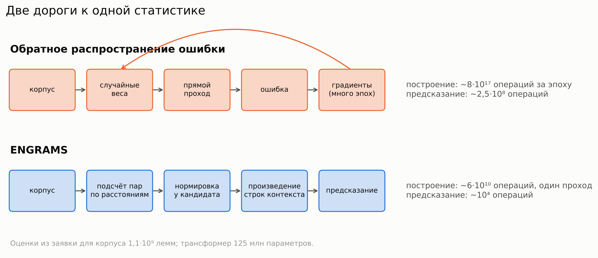
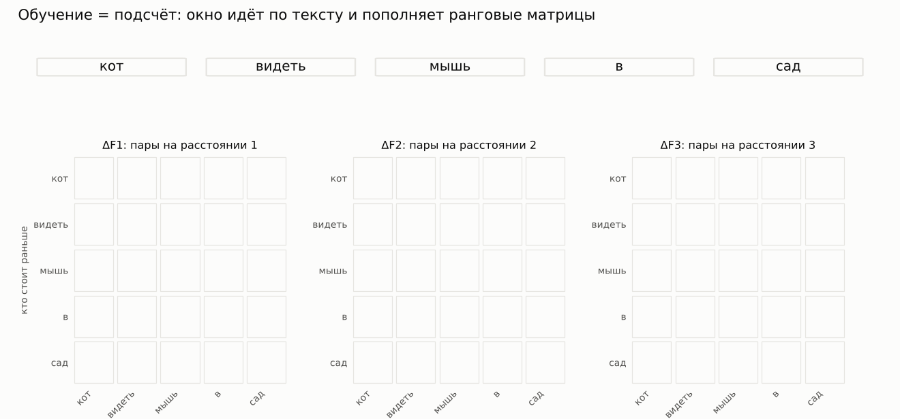
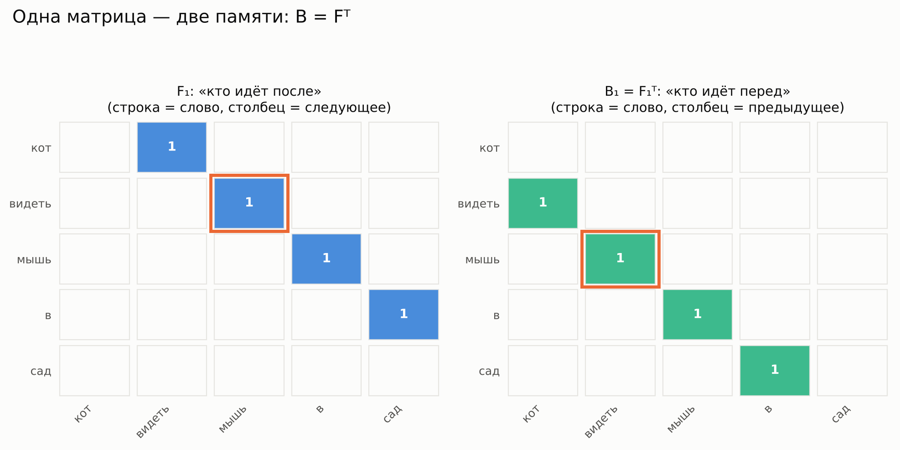
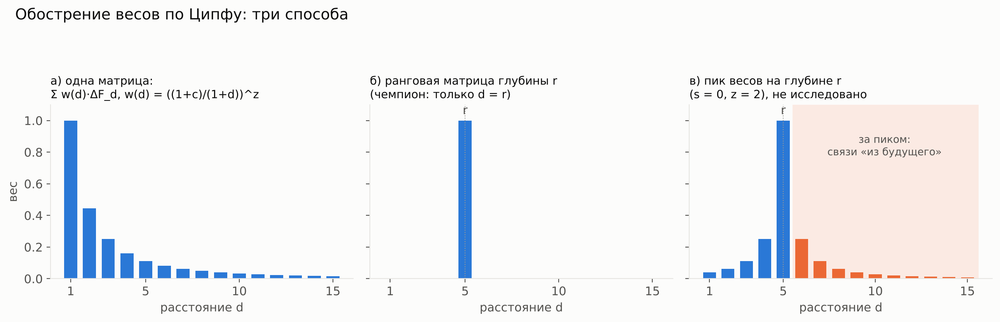
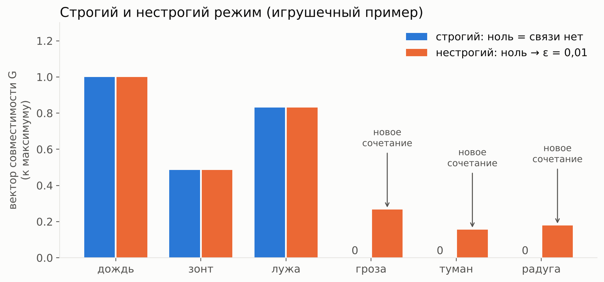
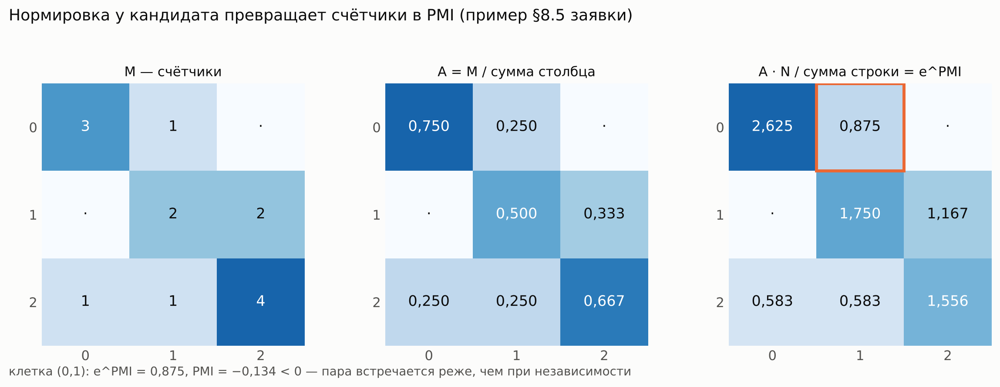
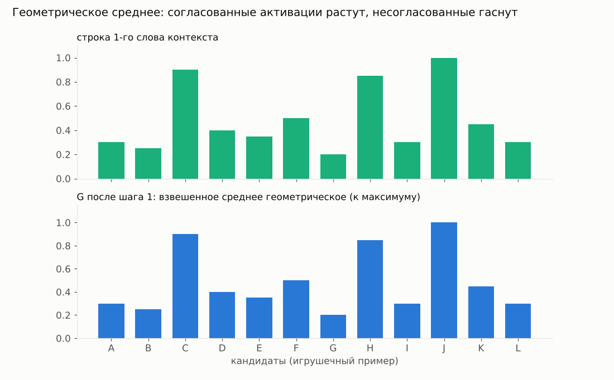
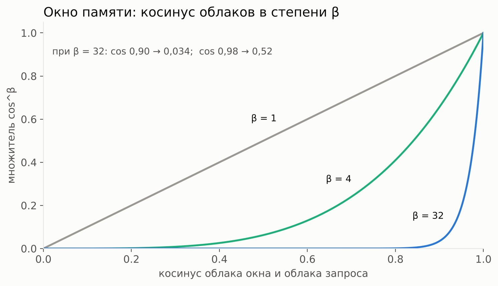
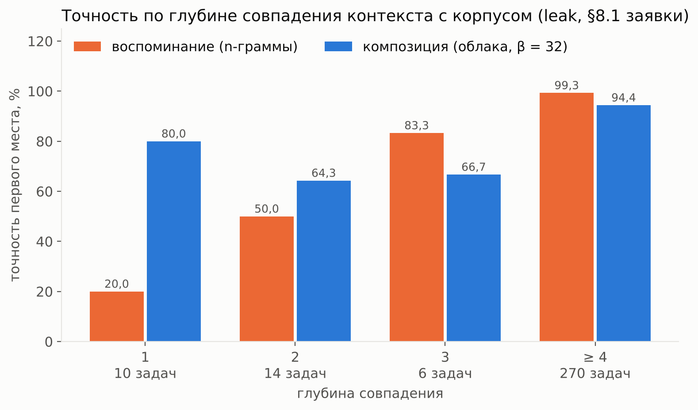
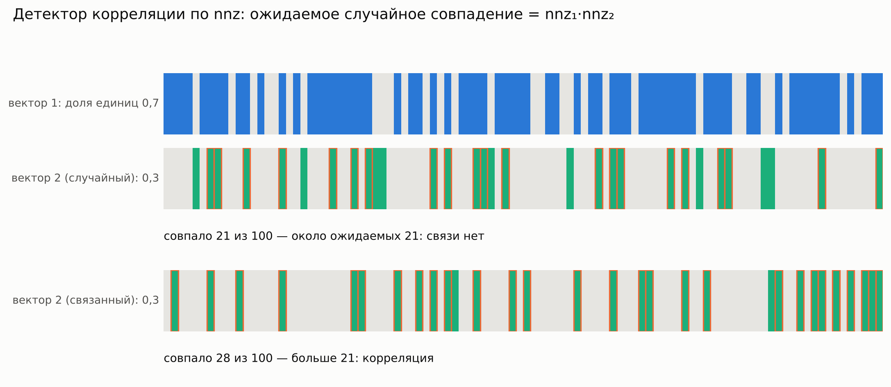

# ENGRAMS, часть 1. Статистика вместо её аппроксимации: модель языка без обратного распространения ошибки

*Серия «ENGRAMS: память последовательностей». Часть 1 из 19 — обзор. Код, рисунки и все числа — в репозитории, тег `part-01`.*

Эта статья — карта всей серии. Здесь нет кода и почти нет формул. Задача одна: показать, чем модель ENGRAMS качественно отличается от привычных нейросетей, обучаемых обратным распространением ошибки, и почему эта разница даёт исследователю возможности, которых у больших моделей нет. Каждый раздел заканчивается ссылкой на часть, где тема разобрана подробно, с кодом, замерами и тупиками, в которые мы заходили.

## 1. Главная мысль

Большую языковую модель учат предсказывать следующий токен. Миллиарды весов подгоняются градиентным спуском, пока поведение модели не станет похожим на поведение токенов в корпусе. По сути обратное распространение ошибки **аппроксимирует статистику поведения токенов**: статистика в модели есть, но растворена в весах, и прочитать её оттуда нельзя.

ENGRAMS идёт короче: **она использует саму статистику**. Мы один раз проходим по корпусу, считаем, какие токены встречаются на каком расстоянии друг от друга, нормируем эти счётчики, и всё. Обучения в смысле градиентного спуска нет. Предсказание собирается из строк матриц счётчиков простыми операциями, и каждую из них можно проследить до конкретных пар слов в корпусе.

Разница в цене получается на порядки. Оценки для нашего корпуса (около 1,1 млрд лемм русской Википедии, словарь 100 005):

| что | трансформер 125 млн параметров | ENGRAMS |
|---|---|---|
| построение модели | около 8·10¹⁷ операций **за одну эпоху** | около 6·10¹⁰ операций, **один проход** |
| одно предсказание | около 2,5·10⁸ операций | около 10⁴ операций |
| хранение памяти окон | полные векторы: 1,46 ТБ | наибольшие координаты: 0,73 ГБ |

Всё, о чём пойдёт речь дальше, посчитано на одном ноутбуке.

## 2. Словарь — это и есть признаки

В нейросети токен превращается в вектор из нескольких тысяч чисел, и что значит каждое из них, неизвестно. В ENGRAMS **строки и столбцы всех матриц — это сами токены**. Клетка «кот × мышь» хранит, сколько раз мышь встретилась после кота на данном расстоянии. Больше ничего.

Если смотреть на токен как на нейрон, а на клетку матрицы как на силу связи между двумя нейронами, получаем сеть, в которой у каждого нейрона есть имя. Отсюда три следствия.

**Полная интерпретируемость.** Каждая операция модели — сложение, умножение, нормировка — выполняется над именованными строками и столбцами. Почему модель предсказала «мышь», можно прочитать: вот строки слов контекста, вот их произведение, вот клетка, давшая максимум. Инженерия знаний становится прозрачной. Если у вас есть мысленная модель того, как должны взаимодействовать нейроны, её можно перенести прямо на уровень матриц и проверить в тот же день.

**Низкий аппаратный порог.** Чтобы исследовать модель, не нужен кластер ускорителей. Матрицы разрежены, предсказание стоит тысячи операций, а не сотни миллионов. Вся работа над ENGRAMS сделана на ноутбуке.

**Демократизация.** Замена градиентного обучения, которое аппроксимирует статистику, самой статистикой снижает вычислительную сложность на много порядков. Это предпосылка к тому, чтобы исследования языковых моделей и их использование на инференсе стали доступны не только крупным лабораториям.

→ Подробно: часть 4 (леммы как объекты), часть 7 (матрицы), часть 17 (чемпион целиком).

## 3. Обучение = подсчёт

### Ранговые матрицы

Окно идёт по тексту. Для каждой пары слов на расстоянии r мы добавляем единицу в клетку матрицы ΔF_r: строка — слово, которое стоит раньше, столбец — слово, которое стоит позже. Матрица ΔF₁ знает соседей, ΔF₂ — слова через одно, и так до ΔF₁₅ в нашем чемпионе.

Ранговую матрицу полезно понимать как **остаточную связь между нейронами глубины r**: связь токена не с ближайшим соседом, а с токеном, отстоящим на r шагов. Тогда модель с R ранговыми матрицами — это модель нейрона, у которого R видов связей с другими нейронами, по одной на каждую глубину. У этой идеи есть и аппаратная форма. Подробно она описана в евразийском патенте EA 044182 (пункты 22–34 формулы): память — это матрица пересекающихся шин, по шине на каждый объект. В пересечениях стоят искусственные нейроны встречаемости: счётчики, которые срабатывают, когда сигнал приходит на обе шины одновременно, и хранят связь отдельно для прямого и обратного направления. Матрица симметрична, поэтому хватает её половины, «косынки». Косынки разных рангов соединяются последовательно в секции, по секции на каждое расстояние, — это и есть ранговые матрицы в железе. В заявке 2026 года та же схема вошла в пункт 59 как устройство для новых способов. Решение наивное, но мы его не проверяли, и в нём может быть зерно для нейроморфных схем и вычислений в памяти.

### B = Fᵀ: одна матрица, две памяти

У сырых матриц памяти последовательностей есть простое и очень полезное свойство. Матрица F₁ отвечает на вопрос «что идёт после слова». Её транспонированная Fᵀ отвечает на вопрос «что идёт перед словом». Второй подсчёт не нужен: **B = Fᵀ**.

Это открывает целый ряд возможностей внутри модели: предсказывать не только следующее, но и предыдущее слово; проверять гипотезу с двух сторон; строить облака «прошлого» и «будущего» одной позиции. Одна оговорка: при транспонировании порядок нормировок по строкам и по столбцам меняется на обратный, и это надо учитывать.

### Обострение весов по Ципфу

Слова влияют на предсказание тем слабее, чем дальше они стоят. Закон убывания мы берём похожим на закон Ципфа: вес расстояния d пропорционален ((1+c)/(1+d))^z. Реализовать это можно тремя способами.

1. **Одна матрица** со встречаемостями на всех расстояниях, каждая со своим весом Ципфа. Это самый простой путь, с него проект начинался.
2. **Ранговые матрицы, умноженные каждая на свой вес.** Для слова контекста на расстоянии r берётся матрица ровно этого расстояния. Так устроен чемпион, и роль весов Ципфа в нём играют показатели степени, с которыми строки входят в произведение (раздел 6).
3. **Ранговые матрицы с пиком весов на выбранной глубине.** Для слова на расстоянии r берётся сумма матриц всех расстояний с весами, убывающими от r в обе стороны. Строки при этом получают **нестрогие** веса: в них попадают связи, лежащие «за пиком». Но это не случайная примесь и не остаточные связи. Это связи **из будущего**, то есть обратные связи.

Третий способ мы не исследовали. Он описан в формуле заявки, но ни одного замера на нём нет. **Приглашаем желающих провести это исследование.** В части 8 будет заготовка скрипта и протокол замера.

→ Подробно: часть 7 (ранговые матрицы и B = Fᵀ), часть 8 (веса Ципфа).

## 4. Строгий и нестрогий режим

В ENGRAMS ноль в матрице означает одно: **хеббовой связи нет**. Эти слова никогда не встречались вместе на таком расстоянии. Самая частая ошибка, которую мы совершали, — заменить ноль маленьким числом ε, «чтобы логарифм не падал». Тогда «связи нет» превращается в «связь есть, но слабая», и модель начинает видеть совместные активации, которых в корпусе не было.

Поэтому у модели два режима.

- **Строгий.** Кандидат, у которого нет связи хотя бы с одним словом контекста, выбывает. Модель статистически корректна: она предлагает только то, что подтверждено корпусом.
- **Нестрогий (EPS).** Нулю присваивается малое положительное значение. Поведение меняется со строго статистического на вероятностное. Модель начинает усиливать сочетания, которых в корпусе не было.

Нестрогий режим — не ошибка, а исследовательский инструмент. Он даёт и грубые ошибки, и находки, которых в корпусе нет: то, что у человека называют догадкой. Значит, к нему нужны фильтры, которые оставляют удачные сочетания и отсеивают бессмыслицу. В заявке предложены два таких фильтра: присваивать значение только кандидатам, поддержанным близкими по смыслу словами, и выдавать предсказание только выше порога независимости. Эффект обоих не измерен.

Цену неосторожной подмены мы знаем по замеру: когда при сравнении облаков общие нули заменили константой 0,01–0,1, относительный разрыв между «своим» и «чужим» упал с 13,8 % до 0,3 %. Константа в общих нулях одинакова для любой пары и стирает различия.

Числа чемпиона получены в строгом режиме; единственное исключение — замер переключателя (раздел 8), сделанный на дампе нестрогого режима. Об этом правиле («правило 0») и о том, как мы вообще меряем, — часть 2.

→ Подробно: часть 2 (правила замера), часть 11 (вектор G).

## 5. Ортогональная нормировка → PMI

Сырые счётчики предсказывают плохо: частые слова («и», «в», запятая) стоят рядом со всем подряд и выигрывают любое голосование. Обычно строки матрицы нормируют, то есть делят на массу слова контекста. Мы нормируем **по столбцам**, то есть у кандидата: каждую клетку делим на общую встречаемость кандидата.

После этого клетка «t × j» означает долю встреч кандидата j, приходящуюся на слово контекста t. Простое на вид изменение имеет точный смысл: нормированная по столбцам клетка, умноженная на N/R_t, есть **экспонента поточечной взаимной информации (PMI)**. У PMI есть абсолютный ноль: ноль означает, что пара встречается ровно так часто, как при независимости.

На рисунке — числовой пример из заявки. Клетка (0,1) после нормировки даёт e^PMI = 0,875, PMI = −0,134: пара встречается реже, чем при независимости. В нашей форме все веса положительны: хранится e^PMI, а не сам PMI, и пара, встречающаяся реже независимости, просто получает вес меньше единицы. Поэтому у нас ничего не отсекается. Обычный путь другой: берут PMI и обнуляют отрицательные значения (PPMI). На языковых данных такая отсечка удалила бы 9–19 % пар в каждой строке, а при пересечении строк в произведении (раздел 6) эти пары нужны.

На замере нормировка по столбцам дала 86,17 % точности первого места против 73,40 % у нормировки по строкам. А если хранить нормированные формы двух порядков, PMI восстанавливается без исходных счётчиков с точностью до одной постоянной на всю матрицу. Это проверено на четырёх настоящих матрицах (256 млн ненулевых) без единого нарушения порядка.

→ Подробно: часть 9 (нормировка и PMI), часть 10 (восстановление PMI без счётчиков).

## 6. Инференс геометрическим средним

Как из строк слов контекста получить предсказание? Мы перемножаем их поэлементно, с показателями степени:

G₁ = v₁, Gₖ = (Gₖ₋₁ · vₖ)^(1/pₖ), pₖ = a(n)·(k−1) + 1,

где vₖ — строка k-го слова контекста, а a(n) = 3,895 / (n − 2,633)^0,941 зависит только от длины контекста n. Предсказание — кандидат с наибольшим значением G. Произведение берётся только по кандидатам, у которых связь есть со всеми словами контекста.

**Почему геометрическое, а не арифметическое среднее.** Арифметическое среднее прощает: кандидат, сильно связанный с одним словом контекста, выигрывает, даже если с остальными не связан никак. Геометрическое среднее не прощает: оно **усиливает согласованные активации и ослабляет несогласованные**. Это правило Хебба на уровне предсказания: «нейроны, которые активируются вместе, связываются». Кандидат побеждает, только если его активируют все слова контекста сразу. На анимации кандидат J силён в первой строке, но во второй его связь почти нулевая, и он гаснет. C и H поддержаны всеми строками и выходят вперёд.

У этой формулы есть несколько эквивалентных прочтений, и каждое полезно по-своему.

1. **Среднее логарифмов, или сумма PMI.** Логарифм G — взвешенная сумма логарифмов строк. После нормировки у кандидата логарифм клетки равен PMI минус постоянная строки, поэтому порядок кандидатов совпадает с порядком по взвешенной сумме PMI с каждым словом контекста.
2. **Логическое «И».** Ноль в любой строке обнуляет кандидата, поэтому носитель G — пересечение носителей строк. Кандидат должен быть связан с первым словом, и со вторым, и с третьим.
3. **Произведение экспертов и наивный Байес.** Каждое слово контекста — эксперт, голосующий вероятностью P(слово | кандидат); нормировка у кандидата даёт ровно её. Без множителя априорной вероятности частые кандидаты не получают преимущества.
4. **Лог-линейная интерполяция моделей по расстояниям.** Каждая ранговая матрица — своя модель, показатели — веса интерполяции. Разница в том, что наши показатели задаются одним правилом по номеру шага, а не подбираются численно для каждого расстояния.
5. **Связывание в векторных символьных архитектурах (VSA).** Поэлементное произведение — операция связывания (binding), а геометрическое среднее — связывание, сохраняющее масштаб. Пост в канале от 14.01.2025.
6. **Геометрическая активация.** Корень из произведения как функция активации нейрона, которая срабатывает только на совпадение входов. Пост в канале 2025 года (не позднее 07.10.2025).
7. **Затухающая память.** Раскрыв рекурсию, получаем, что ближайшее слово входит с показателем 1/pₘ, а каждое более далёкое — с произведением всех последующих делителей. Это экспоненциальное сглаживание в логарифмической шкале: влияние прошлого убывает с каждым новым словом. Отсюда и связь с весами Ципфа из раздела 3.

→ Подробно: часть 11.

## 7. Воспоминания с помощью облаков

Помимо матриц у модели есть память окон: для каждой позиции корпуса хранится вектор её левого контекста и «мешок» слов, которые шли дальше. В чемпионе это 3 654 081 окно.

Чтобы вспомнить продолжение, мы ищем окна, похожие на запрос. Сходство считается дважды. Первый раз — скалярным произведением векторов G окна и запроса: насколько совпадает точный контекст. Второй раз — косинусом **облаков**. Облако — сумма строк матриц всех расстояний для слов прошлого, то есть смысловое поле вокруг позиции. Косинус облаков возводится в степень β = 32, и это резко отсекает окна с похожими словами, но чужой темой.

Предсказание — сумма мешков продолжения лучших окон, взвешенная их оценкой. Это **композиция**: модель собирает ответ из похожих, но не совпадающих контекстов, и может предсказать то, что в таком контексте ни разу не встречалось. На замере композиция дала 92,00 % точности первого места, а на знаменательных словах — 100 %.

→ Подробно: часть 12 (облака), часть 13 (память окон), часть 14 (воспоминание облаками).

## 8. Воспоминания с помощью n-грамм и переключение

Второй способ вспомнить — найти в памяти места, где последние слова контекста совпадают с корпусом дословно, и проголосовать словами, которые там шли дальше. **Глубина совпадения** — сколько последних слов совпало подряд.

Две головы хороши в разных местах. Когда совпадение глубокое, дословное воспоминание почти не ошибается. Когда совпадение мелкое, лучше работает композиция.

Отсюда простое правило: при глубине не меньше порога h₀ выдаём воспоминание, при меньшей — композицию. Глубина — непрерывный маркер, она доступна на каждой задаче до всякого предсказания. Переключение дало 98,67 % против 92,00 % у лучшего постоянного слияния двух голов: 10 задач выиграно, 0 проиграно, p = 0,002 (150 отчётных задач, дамп нестрогого режима). Композиция при этом считается только на 8 % позиций.

→ Подробно: часть 15 (n-граммы), часть 16 (переключение).

## 9. Детектор корреляции по nnz

Ещё одна простая идея (первым это наблюдение сделал Алексей Тарасов в своём канале). Пусть у двух бинарных векторов доля единиц 0,7 и 0,3. Если они независимы, единицы случайно совпадут примерно в 0,7 · 0,3 = 0,21 позиций. Совпадений заметно больше — векторы связаны, меньше — отталкиваются.

Обобщение детектора на непрерывную функцию весов вместо бинарной сделано в ENGRAMS для нашего случая: векторов с весами много меньше единицы. Для векторов, нормированных по L1, ожидаемое скалярное произведение при независимости равно 1/N_V. Для нормированных по L2 оно равно √(nnz_X · nnz_Y)/N_V. Обобщение вошло в заявку как порог для окон памяти и для проверки дословного совпадения по смыслу. **В чемпионе оно не использовалось и не измерялось**, так что это ещё одно открытое направление.

→ Подробно: часть 19.

## 10. Что уже проверено

Этот раздел будет в каждой части. В нём собраны эксперименты по темам части: сначала удачные, потом неудачные, с числами из рабочих отчётов. Цель простая: не тратить ваше время на то, что уже сделано. Если вы хотите повторить опыт, повторяйте его ради проверки, а не ради открытия.

Как читать числа. Почти везде это **точность первого места** (@1): доля задач, где верное слово стоит первым. **Leak** — окно задачи есть в памяти, проверяется точность узнавания. **Gen** — окрестность задачи ±30 позиций вырезана из памяти, проверяется обобщение. «Знаменательные» — задачи, где нужно предсказать смысловое слово, а не предлог или запятую. Подробно о замерах — часть 2.

### Что сработало

| что проверяли | результат | условия замера | подробно |
|---|---|---|---|
| Показатель Ципфа z в одной матрице, веса 1/(d+1)^z | из z = 0,1; 0,5; 5; 10 лучшим оказалось **z = 5**. При z = 0,1 и 0,5 точность падает примерно вдвое, при z = 10 — на 2–3 %. Таблицы по каждому z в найденных отчётах нет, только эти оценки | BPE, 32 041 токен; обучение на 200–400 МБ Википедии; 1000 позиций вне обучения | часть 8 |
| Геометрическое среднее с показателем, зависящим от длины контекста | @1 от 15,0 % (контекст 3) до 19,3 % (контекст 1000), топ-10 около 46 %. Оптимальный показатель убывает с длиной по гиперболе; из четырёх аппроксимаций гипербола точнее всех (RMSE 0,11 против 0,34–4,39) | та же установка, 12 длин контекста | часть 11 |
| Нормировка по столбцам (у кандидата) против нормировки по строкам | **86,17 % против 73,40 %** | вектор G в памяти окон, leak, знаменательные, длина 15 | часть 9 |
| Двойная нормировка: сначала столбцы, потом строки | на gen одна столбцовая уступала строчной (33,77 % против 35,71 %); двойная нормировка принята как лучшая | gen | часть 9 |
| Строгий режим против нестрогого (канал G памяти окон) | строгий нигде не хуже и лучше в четырёх точках сравнения из семи; без множителя облаков **74,31 % против 70,14 %**. Носитель G: медиана 133–136 кандидатов в строгом режиме против 25 105 в нестрогом | leak, 144 задачи на знаменательные слова | части 2, 11 |
| Косинус облаков в степени β | переход от β = 0 к β = 32 поднял точность с 74,31 % до **100 %** на leak и на 3,47 пункта на gen | 144 задачи (leak) | часть 14 |
| Переключение по глубине совпадения | **98,67 % против 92,00 %**, 10 задач выиграно, 0 проиграно, p = 0,002 | 150 отчётных задач, дамп нестрогого режима | часть 16 |
| Согласование запроса и памяти | одинаковая граница контекста: 53,87 % против 22,54 %; одинаковый предел ранга (15 и 15): 53,52 % против 41,55 % | leak, 284 задачи | часть 13 |
| Ципф в мешке продолжения (где берётся argmax) | **46,83 % против 10,92 %** у линейных весов | leak, 284 задачи | часть 13 |
| Линейные веса в мешке отбора (где считается косинус) | **52,82 %** против 43,31 % у бинарного мешка и 3,52 % у мешка с весами Ципфа | leak, 284 задачи | часть 12 |
| Маскирование неизвестного слова [UNK] | +3 пункта во всех конфигурациях | leak, 284 задачи | часть 4 |

Из двух последних строк выросло правило, которое стоит запомнить: **веса Ципфа — там, где берётся argmax; линейные веса — там, где считается косинус.** Ципф сжимает вектор до двух-трёх ближайших слов, и косинус между такими векторами теряет смысл.

### Что не сработало

| что проверяли | результат | условия замера | подробно |
|---|---|---|---|
| Ранговые матрицы на малом корпусе | провал: −22 % на топ-10. Матрицы заполнены на 0,6–1,1 % против 25 % у одной матрицы, и произведению не хватает общих ненулевых. На полном корпусе (1,1 млрд лемм) ранговые матрицы стали основой чемпиона | 200–400 МБ текста | часть 7 |
| Дополнительные веса Ципфа поверх ранговых матриц | монотонный спад: z = 0 → 41,55 %, 0,5 → 40,85, 1 → 36,62, 2 → 26,06, 3 → 23,24, 5 → 20,77. Затухание уже задают показатели рекурсии G; второе затухание выключает всё дальше второго слова, и G вырождается в биграмму | leak, 284 задачи | часть 8 |
| Перевзвешивание строк перед произведением: отсечка по перцентилю, адаптивная отсечка, усиление контраста, softmax и softmax с температурой, LayerNorm + ReLU | ни одно не помогло: от 0 до +0,3 пункта в лучшем случае, от −5 до −22 в худшем | BPE, 1000 позиций | часть 11 |
| Нормировка PVS (σ = 1 и σ = 1500) вместо L2 | результат совпал с L2 | BPE, 1000 позиций | часть 9 |
| Постоянный показатель α вместо a(n) | 13,20 % против 13,47 % (топ-100: 62,67 % против 62,93 %), разницы практически нет. Вариант оставлен в формуле, но выигрыша не даёт | леммы, одна матрица, контекст 30, 750 позиций | часть 11 |
| Композиции матриц F, B, Fᵀ, Bᵀ (все 16 пар) | лучшая, Bᵀ·B, даёт 5 % против 19 % у самой F. Fᵀ·F — матрица сходства слов, а не переходов, и предсказательную силу F не наследует | BPE | часть 9 |
| Облако вместо вектора G при поиске окон | 26,16 % против 48,55 % на первом месте. Зато верный ответ в топ-10 в 93,9 % случаев, поэтому облака стали первым, дешёвым этапом отбора | leak, 344 задачи | часть 12 |
| Облако запроса из вектора G, а не из суммы строк облаков | 2,62 % против 26,16 %: запрос и окна должны жить в одном пространстве | leak, 344 задачи | часть 12 |
| Столбцовая нормировка в косинусе отбора и в множителе облаков | не помогает; работает только внутри произведения G. Но и там прирост только на leak (70,21 → 80,85 %), на gen его нет: изменения в доли процента, на уровне шума | leak и gen | часть 9 |
| Замена общих нулей константой 0,01–0,1 при сравнении облаков | относительный разрыв «своё — чужое» упал с 13,8 % до 0,3 % | сравнение облаков | части 4, 12 |
| Разложение векторов слов на «базис служебных слов» и смысловую часть, v = √(d·s) | не получилось: служебные слова не образуют общего базиса. Предлоги почти не похожи друг на друга (близость внутри группы 0,08–0,12) | кластеризация служебных слов | часть 18 |

### Что не измерено

Без замеров остались пик весов Ципфа на выбранной глубине, фильтры нестрогого режима, детектор корреляции по nnz и степень A^α @ B^α при перемножении матриц. Прямого сравнения геометрического и арифметического среднего на одной установке в отчётах тоже нет: в пользу геометрического говорит провал всех попыток перевзвесить строки (таблица выше), но отдельной таблицы «геометрическое против арифметического» нет. Это хорошие задачи для тех, кто хочет присоединиться.

## 11. Что дальше

Модель построена, проверена и описана. Многие направления только намечены, и мы хотим, чтобы ими занялись не только мы.

- **Пик весов Ципфа на выбранной глубине** — связи «из будущего» (раздел 3).
- **Фильтры для нестрогого режима**: как оставлять находки и отсеивать бессмыслицу (раздел 4).
- **Детектор корреляции по nnz** в отборе окон (раздел 9).
- **√A @ √B вместо A @ B**, и шире — степень A^α @ B^α при перемножении матриц встречаемости. При строках-распределениях √A @ √Aᵀ даёт коэффициент Бхаттачарии и метрику Хеллингера. Не исследовано.
- **Больше памяти.** Сейчас память окон покрывает два фрагмента корпуса из 584, около 0,7 %. На режиме gen, где окрестность задачи исключена из памяти, это главный предел: точность композиции 26,00 %, воспоминания 33,67 %. Восемь фрагментов вместо двух подняли лучшую точность на gen с 34,00 до 41,33 %.

## Как читать серию

| блок | части |
|---|---|
| Картина и правила | 1 — обзор; 2 — как мы меряем |
| Данные и объекты | 3 — корпус; 4 — леммы; 5 — почему не BPE и не слоги; 6 — отрезки и пары |
| Обучение = подсчёт | 7 — ранговые матрицы и B = Fᵀ; 8 — веса Ципфа; 9 — нормировка и PMI; 10 — PMI без счётчиков |
| Инференс | 11 — геометрическое среднее; 12 — облака; 13 — память окон; 14 — воспоминание облаками; 15 — n-граммы; 16 — переключение; 17 — чемпион целиком |
| Словарь и что дальше | 18 — общая лексика и имена; 19 — итоги и открытые направления |

В каждой части будут код, который можно запустить, числа с указанием, чем и на чём они получены, и разбор подходов, которые не сработали.

---

*Все числа — из заявки на изобретение (подана 21.11.2026) и отчётов проекта; на рисунках 1, 6 и 9 настоящие данные, на остальных — игрушечные примеры. Рисунки пересобираются скриптом `docs/figures/make_part01_figures.py`. Код — PolyForm Noncommercial 1.0.0: свободно для исследований, обучения и некоммерческих целей; коммерческое использование — по лицензии автора (см. `COMMERCIAL.md`). Канал автора: [t.me/sequence_memory](https://t.me/sequence_memory).*
