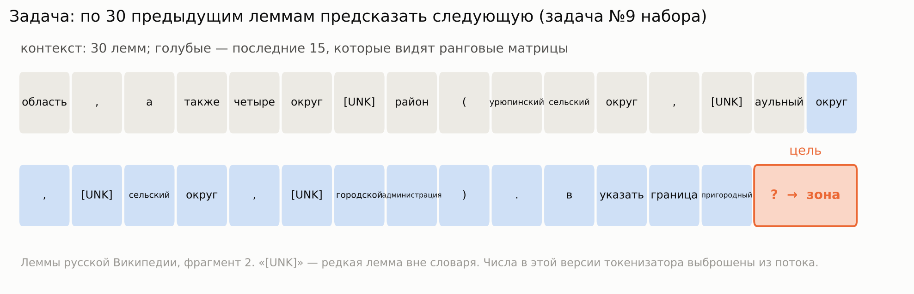
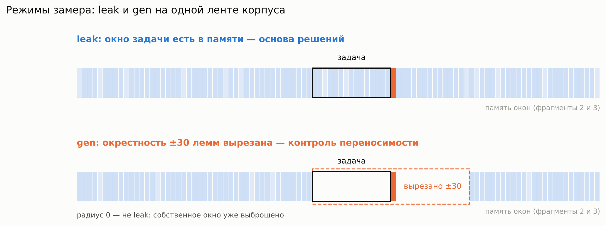
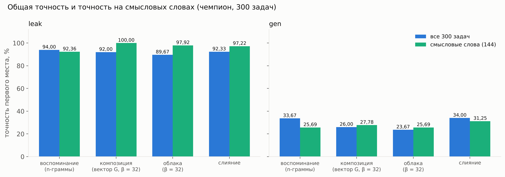
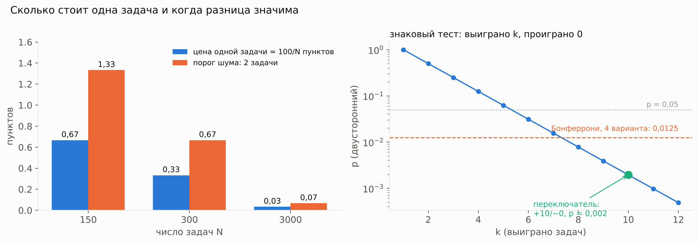

# ENGRAMS, часть 2. Как мы меряем: задачи, режимы leak и gen, шум и правило нуля

*Серия «ENGRAMS: память последовательностей». Часть 2 из 19. Код, рисунки и все числа — в репозитории, тег `part-02`.*

> ## 🤝 Зачем мы открываем эту работу
>
> **Цель публикации — собрать сообщество: группу людей, которым интересна эта работа и которые хотели бы присоединиться к проекту.** Код, результаты и открытые вопросы выложены для того, чтобы их можно было проверять, развивать и исследовать вместе. Если вам интересно, напишите в группе обсуждения [t.me/sequence_memory](https://t.me/sequence_memory) или откройте issue в этом репозитории. Публикации серии выходят в канале [t.me/E_N_G_R_A_M_S](https://t.me/E_N_G_R_A_M_S), обсуждение идёт в группе @sequence_memory, привязанной к каналу. Так части серии идут в канале подряд и не теряются среди вопросов и комментариев.

Любое число в этой серии понятно, только если известно, как его получили. Самые дорогие ошибки проекта были ошибками не модели, а замера: числа без пометки режима, сравнение результатов на разных наборах задач, замер не того, что собирались мерить. Эта часть описывает, как устроен замер и какие правила появились после каждой такой ошибки. Все дальнейшие части опираются на неё.

## 1. Задача

Модель получает 30 лемм подряд и должна предсказать следующую. Например, задача №9 нашего набора:

Правильный ответ — «зона» («в указанных границах пригородной зоны»). Верная лемма на первом месте засчитывается, на втором — нет. Метрика — **точность первого места** (@1): доля задач, где верная лемма стоит первой.

Набор задач собран так:

- **Источник** — фрагмент 2 русской Википедии из 584 (1 815 018 лемм). Те же леммы, на которых строится модель (часть 4).
- **Позиции** — 3000 случайных мест фрагмента. Первые 500 выбраны с seed 42, остальные 2500 дописаны с seed 4242 так, чтобы старые задачи остались теми же, под теми же номерами: иначе числа старых прогонов перестали бы быть сравнимыми с новыми.
- **Фильтр цели** — берутся задачи, у которых цель входит в 1000 самых частых лемм корпуса. Под фильтр попадают 2820 задач из 3000. Это ограничение надо помнить: числа серии описывают предсказание частой лексики, редкие леммы в замер не входят.
- **Объём** — первые 300 задач, прошедшие фильтр. Это рабочий объём всех замеров серии; там, где выводы перепроверялись на большем числе задач, это указано.

Набор лежит в репозитории: `data/tasks/`. Там же скрипт, который из него выбирает эти 300 задач и печатает их состав.

Леммы в этой версии токенизатора — буквенные токены. Знаки препинания — полноправные объекты, их тоже надо предсказывать. Числа из потока выброшены, а редкие леммы вне словаря заменены на `[UNK]`, это 5,13 % потока. Подробно — часть 4.

## 2. Два режима: leak и gen

Модель ENGRAMS — это матрицы встречаемости плюс **память окон**: для каждой позиции корпуса хранится её контекст и то, что шло дальше. Память и есть обученная модель. Поэтому «тест на отложенных данных» в привычном смысле здесь значит другое, и режимов замера два.

- **Leak** (утечка). Окно задачи есть в памяти. Это **основной режим**: по нему принимаются все решения. Он отвечает на вопрос, умеет ли модель найти и использовать то, что она знает. Исключать память из замера бессмысленно: без статистики модель — как Маугли без языка.
- **Gen** (обобщение). Из памяти вырезана окрестность задачи ±30 лемм. Это **контроль**: он показывает, что модель делает на незнакомом месте, и следит за переносимостью той части модели, которая держится только на матрицах. Рост gen — признак, что улучшение не сводится к узнаванию.

**Каждое число в серии помечено режимом.** Число без режима недействительно. В разделе 8 — история о том, почему это правило стало обязательным.

Есть и ловушка. Окна исключаются фильтром «расстояние до задачи **больше** радиуса». При радиусе 0 собственное окно задачи уже выброшено. Значит, радиус 0 — это не утечка, а промежуточный режим, который ничего не измеряет. Утечка — только при радиусе −1, когда не исключается ничего.

## 3. Смысловые и служебные цели

Из 300 задач у 144 цель — смысловое слово, у 156 — служебное: знак препинания или слово из короткого списка служебных: предлоги, союзы, местоимения, частицы, глаголы «быть», «мочь», «стать», «являться» и несколько наречий вроде «уже» и «ещё». Список лежит в скрипте выбора задач. Общая точность больше говорит о служебных словах, чем о смысле.

Поэтому мы даём оба разреза. На рисунке видно, зачем. Композиция по вектору G на leak даёт 92,00 % в общем зачёте и **100 %** на смысловых словах. Воспоминание n-граммами, наоборот, на смысловых словах слабее (92,36 %), чем в среднем (94,00 %). По одному общему числу эту разницу не увидеть, и выбор между механизмами был бы сделан неверно.

## 4. Шум: сколько стоит одна задача

Одна задача стоит 100/N процентных пунктов. На 300 задачах это 0,33 пункта, на 150 — 0,67. **Прибавка меньше двух задач от шума неотличима**, и мы её не засчитываем.

**Решения принимаются по трём правилам.**

1. **Критерий объявляется до замера.** До запуска записывается, что считается успехом и почему этот порог выше шума. Подогнать критерий под полученное число нельзя.
2. **Варианты сравниваются знаковым тестом.** Смотрим только на задачи, где два варианта расходятся: сколько выиграл один и сколько другой. Если перебиралось несколько вариантов, порог значимости делится на их число (поправка Бонферрони).
3. **Подбор и отчёт — на разных половинах.** Если у метода есть порог, его подбирают на одной половине задач, а результат сообщают по другой.

Пример — переключатель между воспоминанием и композицией из части 1. Набор из 300 задач разделён пополам. Порог глубины подобран на первой половине. Перебирались 4 варианта маркера, поэтому порог значимости 0,05 / 4 = 0,0125. На второй, отчётной половине (150 задач) переключатель дал 98,67 % против 92,00 % у постоянного слияния двух голов: 10 задач выиграно, 0 проиграно, p = 0,002. Это ниже 0,0125, результат принят.

## 5. Сравнивать сравнимое

Два числа сравниваются, только если у них одинаковы: память, набор задач, длина контекста, нормировка и режим. Числа, снятые на разных наборах, не сравниваются никогда, даже если разница выглядит убедительной.

К этому же правилу относится **согласование запроса и памяти**. Вектор G считается в двух местах: при построении памяти окон и при обработке запроса. Если поменять формулу в одном месте и забыть в другом, память будет построена одной формулой, а запрос — другой, и замер покажет мусор. То же касается шага окон, длины контекста, предела рангов и минимального контекста. Скрипт замера печатает, какой режим G у запроса и какой у памяти, и явно подтверждает совпадение.

Цену рассогласования мы знаем по замерам (часть 13): разная граница контекста в запросе и памяти — 22,54 % вместо 53,87 %; разный предел рангов (60 в памяти, 15 в запросе) — 41,55 % вместо 53,52 %.

## 6. Правило 0: ноль — не малое число

В строгом режиме ENGRAMS ноль в матрице означает: **хеббовой связи нет**. Подмена нуля малым числом (`+1e-10`, `max(x, tiny)`, «чтобы логарифм не падал») превращает «связи нет» в «связь есть, но слабая» и создаёт совместные активации, которых в корпусе не было. Это меняет и состав кандидатов, и их порядок.

Поэтому в коде замера нет ни одной такой подмены. Вместо неё:

| ситуация | вместо подмены |
|---|---|
| ноль под логарифмом | координата не участвует (−∞ в логарифмической шкале) |
| ноль в знаменателе | элемент исключается из рассмотрения, это записывается в лог |
| нулевая норма вектора | вектор исключается из кандидатов, это записывается в лог |

Как это соотносится с нестрогим режимом из части 1? Нестрогий режим — это **явное исследовательское решение**, а не случайная «страховка» в коде. Он включается отдельно, его числа всегда помечены как нестрогие, и он не смешивается со строгими замерами. Единственное число чемпиона, снятое на дампе нестрогого режима, — замер переключателя, и это указано рядом с ним.

## 7. Воспроизводимость

Три простых правила, которые сэкономили больше всего времени.

- **Копия скрипта рядом с данными.** Каждый скрипт кладёт свою копию и файл `meta.json` в папку с данными, которые он создал. Открыв папку, сразу видно, чем она построена. Копию задним числом не правят, даже если в ней найдена ошибка: ошибка описывается в `meta.json` и в отчёте.
- **Ничего не удаляется безвозвратно.** Ненужное переносится в карантин, удаляется только после проверки.
- **Один запуск — одна самодостаточная ячейка.** Ячейка Jupyter содержит все пути, параметры и команды одного шага и запускается сама по себе. Долгие проходы умеют продолжаться с места остановки.

Полный текст правил проекта — в `docs/RULES.ru.md` (английская версия — `docs/RULES.en.md`).

## 8. Что уже проверено

Как и в каждой части, здесь собраны проверки по теме: сначала то, что сработало, потом ошибки, потом то, что не измерено. В этой части это ошибки самого замера. Все они случились на самом деле, и каждая стоила дней работы.

### Что сработало

| что проверяли | результат | условия | подробно |
|---|---|---|---|
| Переключатель, подбор порога на половине задач и отчёт на другой | 98,67 % против 92,00 %, +10/−0, p = 0,002 при пороге 0,0125 (4 варианта) | leak, 150 отчётных задач, дамп нестрогого режима | часть 16 |
| Разрез целей на смысловые и служебные | показал, что общая точность в основном описывает служебные слова: в одной из серий 190 служебных целей против 94 смысловых, а «превосходство» старого чемпиона (74,65 % против 65,14 %) целиком набиралось на служебных словах (75,79 % против 61,05 %); на смысловых новый вариант был лучше (73,40 % против 72,34 %) | leak, 284 задачи | часть 13 |
| Маскирование `[UNK]` при подсчёте | +3 пункта во всех конфигурациях, стало обязательной настройкой | leak, 284 задачи | часть 4 |
| Согласование запроса и памяти | граница контекста: 53,87 % против 22,54 %; предел рангов: 53,52 % против 41,55 % | leak, 284 задачи | часть 13 |

### Что не сработало: ошибки замера

| ошибка | что случилось | правило, которое из неё выросло |
|---|---|---|
| Числа без пометки режима | серия замеров показала 24–33 % вместо эталонных 68 %, это приняли за деградацию механизма. На деле новые числа были сняты на gen, а эталон — на leak. На leak тот же механизм давал 92–100 % | у каждого числа стоит режим (раздел 2) |
| Радиус исключения 0 | прогон с радиусом 0 назвали режимом утечки и потратили на него время. При радиусе 0 собственное окно задачи уже исключено, так что это не leak | утечка — только радиус −1 (раздел 2) |
| Разные наборы задач | слияние голов мерили на 1164 задачах, переключатель — на 582. Разница 24,40 % против 25,26 % оказалась артефактом разных наборов | сравнивать только на одном наборе (раздел 5) |
| Критерий после замера | выводы о «лучшей» настройке делались по общему числу, без заранее объявленного порога, и часть из них после разреза целей пришлось отозвать | критерий до замера, знаковый тест, Бонферрони (раздел 4) |
| Подмена нуля малым числом | при сравнении облаков общие нули заменили константой 0,01–0,1; относительный разрыв «своё — чужое» упал с 13,8 % до 0,3 % | правило 0 (раздел 6) |
| Кросс-доменный набор | скрипт сборки задач для других доменов (юридические тексты, проза, поэзия) токенизировал текст в неверном порядке. Числа по другим доменам, полученные до исправления, требуют перепроверки, и в серии мы их не приводим | проверять набор задач по исходному потоку |

### Что не измерено

- **Сравнение с большими языковыми моделями на общей задаче.** Наша метрика своя, со стандартными бенчмарками LLM модель не сравнивалась. Есть только оценки вычислительной цены (часть 1).
- **Разброс по случайным наборам задач.** Все числа сняты на одном наборе. Насколько они меняются на другом случайном наборе из того же фрагмента, мы не измеряли.
- **Редкая лексика.** Фильтр по 1000 самым частым леммам оставляет её за пределами замера.
- **Знакомство с доменом.** Есть замысел измерять его по самому контексту, без разметки, но он не реализован.

Это хорошие задачи для тех, кто хочет присоединиться.

## 9. Что дальше

Следующий блок серии — данные и объекты: корпус (часть 3), леммы (часть 4), почему не BPE и не слоги (часть 5), отрезки и пары (часть 6).

---

*Числа — из отчётов проекта и заявки на изобретение (подана 21.11.2026). Рис. 1 — настоящая задача из набора, рис. 4 — числа чемпиона, рис. 2 и 3 — схемы. Рисунки пересобираются скриптом `docs/figures/make_part02_figures.py`. Код — PolyForm Noncommercial 1.0.0: свободно для исследований, обучения и некоммерческих целей; коммерческое использование — по лицензии автора (см. `COMMERCIAL.md`). Публикации: канал [t.me/E_N_G_R_A_M_S](https://t.me/E_N_G_R_A_M_S); обсуждение: группа [t.me/sequence_memory](https://t.me/sequence_memory).*
