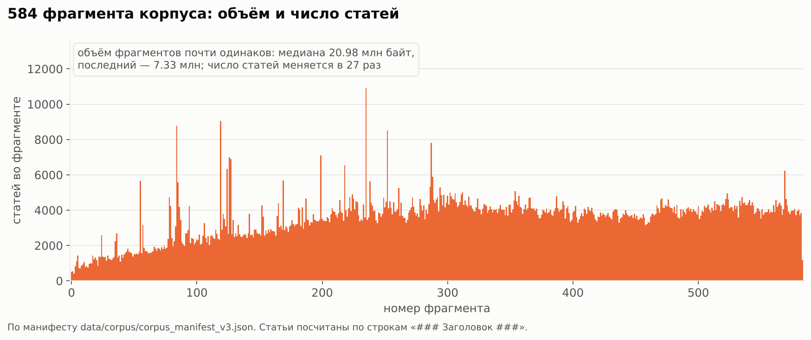
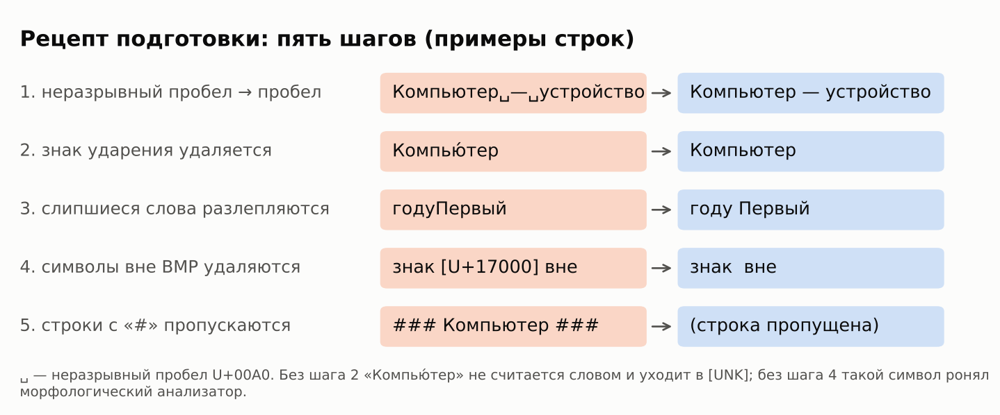
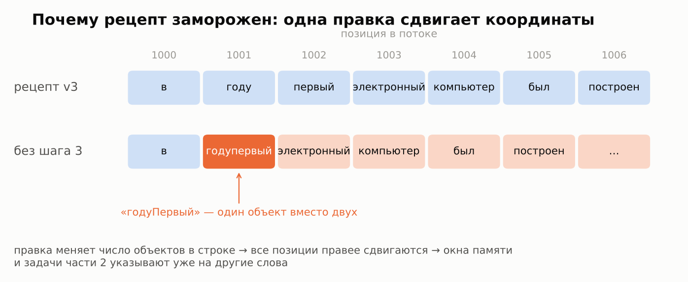

# ENGRAMS, часть 3. Корпус: откуда текст и почему рецепт подготовки нельзя менять

*Серия «ENGRAMS: память последовательностей». Часть 3 из 19. Код, рисунки и все числа — в репозитории, тег `part-03`.*

> ## 🤝 Зачем мы открываем эту работу
>
> **Цель публикации — собрать сообщество: группу людей, которым интересна эта работа и которые хотели бы присоединиться к проекту.** Код, результаты и открытые вопросы выложены для того, чтобы их можно было проверять, развивать и исследовать вместе. Если вам интересно, напишите в группе обсуждения [t.me/sequence_memory](https://t.me/sequence_memory) или откройте issue в этом репозитории. Публикации серии выходят в канале [t.me/E_N_G_R_A_M_S](https://t.me/E_N_G_R_A_M_S), обсуждение идёт в группе @sequence_memory, привязанной к каналу. Так части серии идут в канале подряд и не теряются среди вопросов и комментариев.


Модель ENGRAMS — это статистика корпуса. Всё, что она знает, она знает из текста, и каждое её предсказание можно проследить до конкретных мест этого текста. Поэтому корпус здесь — не «данные для обучения», которые можно заменить на похожие, а сама модель в сыром виде. Эта часть описывает, откуда взят текст, как он подготовлен и почему рецепт подготовки заморожен.

## 1. Откуда текст

Корпус — русская Википедия. Источник — официальный дамп `ruwiki-latest-pages-articles.xml.bz2` с dumps.wikimedia.org: скрипт сборки брал последний дамп на момент запуска. Скрипт создан 29.12.2025, и этой же датой помечена часть фрагментов, так что дамп — последний доступный на конец декабря 2025 года.

> ⚠ **[Точная дата дампа будет вписана по файлу дампа перед публикацией.]**

Сборку делает скрипт `scripts/part03/download_wiki_ru.py`:

- берутся только статьи (пространство имён 0) и только последняя ревизия каждой;
- вики-разметка снимается библиотекой mwparserfromhell (`strip_code`): у ссылок остаётся видимый текст, а у ссылок на категории — их название;
- статьи короче 100 знаков пропускаются;
- каждая статья пишется как `### Заголовок ###`, пустая строка и текст;
- текст режется на фрагменты по 20 МиБ: новый фрагмент начинается, как только текущий достиг этого объёма.

Получилось **584 фрагмента** общим объёмом 12 240 801 052 байта (11,4 ГиБ). Фрагменты почти одинаковы по объёму: медиана 20,98 млн байт (порог 20 МиБ плюс хвост последней статьи), последний — 7,33 млн. В конце статей остаются строки `Категория:…`: ссылка на категорию после снятия разметки превращается в обычный текст. По строкам заголовков в корпусе **2 076 119 статей**, от 400 до 10 909 во фрагменте.



Число статей меняется в 27 раз при почти равном объёме. Значит, в первых фрагментах статьи в среднем намного длиннее. Статьи идут в порядке дампа; почему в его начале длинные статьи, мы не проверяли; для замеров важно другое: задачи части 2 взяты из фрагмента 2, где всего 400 статей, то есть это длинные энциклопедические тексты.

Текст Википедии распространяется по лицензии CC BY-SA 4.0. Манифест фрагментов (имя, размер, md5, число статей, первый заголовок) лежит в `data/corpus/corpus_manifest_v3.json`. По md5 любой, кто соберёт корпус заново, может проверить, что получил те же файлы.

## 2. Подготовка: пять шагов

Перед лемматизацией каждая строка проходит один и тот же рецепт:



```python
text = text.replace('\xa0', ' ')                          # 1. неразрывный пробел
text = text.replace('́', '')                         # 2. знак ударения
text = re.sub(r'([а-яёa-z])([А-ЯЁA-Z])', r'\1 \2', text)  # 3. слипшиеся слова
text = ''.join(c for c in text if ord(c) < 0x10000)       # 4. символы вне BMP
# 5. построчно; строки, начинающиеся с '#', пропускаются
```

Каждый шаг закрывает конкретную поломку.

1. **Неразрывный пробел.** В Википедии он стоит между числом и единицей, перед тире, в инициалах. После замены это обычный пробел, и разбор на слова идёт одинаково для обоих видов пробела.
2. **Знак ударения.** В Википедии ударение ставят в первой строке статьи: «Компью́тер». Знак U+0301 — отдельный символ, и слово с ним перестаёт быть буквенным: оно уходит в `[UNK]`, причём в самом важном месте статьи — в определении.
3. **Слипшиеся слова.** В выгруженном тексте встречаются склейки вида «годуПервый». Строчная буква, за которой сразу идёт заглавная, внутри русского или латинского слова почти не встречается, поэтому такое место разрезается.
4. **Символы вне BMP.** Редкие символы с кодом от 0x10000 (древние письменности, редкие иероглифы, эмодзи) роняли морфологический анализатор. Встречаются они редко, но одного хватает, чтобы остановить многочасовой проход.
5. **Строки с `#`** — это заголовки статей. В поток лемм они не входят.

Код рецепта с примерами — `scripts/part03/preprocess_v3.py` (запуск с `--demo` показывает каждый шаг).

## 3. Почему рецепт заморожен

После подготовки текст превращается в поток объектов — лемм и знаков препинания (часть 4). У каждого объекта есть **координата**: номер фрагмента и позиция в потоке. На этих координатах держится всё остальное: окна памяти (часть 13), набор задач (часть 2), границы предложений.



Любая правка рецепта меняет число объектов хотя бы в одной строке. Например, без шага 3 «годуПервый» — один объект вместо двух. Тогда все позиции правее сдвигаются, и окна памяти и задачи указывают уже на другие слова. Ошибки при этом не возникает: числа просто становятся неверными.

Поэтому правило такое: **рецепт меняется только вместе с полной пересборкой всего, что от него зависит, и под новым именем версии**. В v3 рецепт сознательно оставлен прежним, хотя токенизатор менялся: «рецепт предобработки — не изменён (иначе координаты уедут)».

## 4. Что получилось на выходе

| величина | значение |
|---|---|
| объектов в потоке (леммы, знаки, `[UNK]`) | 1 080 086 644 |
| предложений | 85 527 922 (≈ 12,6 объекта на предложение) |
| фрагментов, у которых поток лемм и поток морфологии совпали по длине | 584 из 584 |
| объектов во фрагменте 2 (задачи части 2) | 1 815 018 |
| время: словарь лемм / потоки | 7 ч 22 мин / 7 ч 50 мин (6 процессов) |

Как из строк получаются леммы, почему числа выпадают из потока и откуда 5,13 % `[UNK]` — в части 4.

## 5. Что уже проверено

### Что сработало

| что проверяли | результат | условия | подробно |
|---|---|---|---|
| Пересборка всего конвейера с исправленной подготовкой (шаги 2 и 4, без `lower()`; заодно знаки препинания стали объектами и был исправлен словарь, см. ниже) | точность первого места 13,20 % против 8,13 % на битых данных | старый замер до серии; режим и число задач в отчёте не указаны; эффект общий для всех исправлений сразу, вклад подготовки отдельно не мерился | — |

### Что не сработало: ошибки

| ошибка | что случилось | что из неё выросло |
|---|---|---|
| `lower()` до лемматизатора | весь текст приводился к строчным до разбора. Лемматизатор терял подсказку заглавной буквы, и леммы получались неверными | регистр не трогается до лемматизации |
| Не удалялись ударения | «Компью́тер» не считался словом и уходил в `[UNK]` — в первой, определяющей строке статьи | шаг 2 |
| Не было фильтра BMP | символ вне BMP ронял морфологический анализатор посреди прохода | шаг 4 |
| Рассинхрон двух словарей | файл «номер → лемма» и файл «лемма → номер» разошлись: `lemma2id['компьютер'] = 2476`, но `id2lemma[2476] = 'наблюдать'`. Счёт шёл верно, а все расшифровки лемм в отчётах были случайными | один словарь — источник истины, второй строится из него |
| Смена фильтра символов посреди прохода | в одном из замеров словаря следующей версии фильтр сменился на 245-м фрагменте из 584: иероглифы, арабица и иврит считались в первых 42 % корпуса и вырезались в остальных. По этим письменностям числа занижены примерно в 2,4 раза | смешение разрешили вручную, чтобы не терять 4 часа, и цену назвали только потом. Правило 13 требует, чтобы проход при смене параметров не продолжался; обходить эту проверку нельзя |

### Что не измерено

- **Влияние домена.** Весь корпус — энциклопедия. Замер на других жанрах был, но с ошибкой в сборке задач (часть 2), так что ответа пока нет.
- **Строки категорий.** Рецепт пропускает только заголовки, поэтому строки `Категория:…`, оставшиеся после снятия разметки, попадают в поток. Какую долю потока они занимают и как влияют на предсказание, мы не мерили.
- **Дубликаты и шаблонные статьи** (однотипные статьи о населённых пунктах, видах, годах). Их доля не измерялась.
- **Число статей.** По строкам заголовков — 2 076 119; в одном из рабочих отчётов записано 2 087 814. Расхождение в 11 695 статей не разобрано.

Это хорошие задачи для тех, кто хочет присоединиться.

## 6. Что дальше

Часть 4 — леммы как объекты: токенизатор v3, словарь из 100 005 элементов и почему числа выпадают из потока.

---

*Числа — из отчётов проекта и манифеста фрагментов. Рис. 2 — настоящие данные, рис. 1 и 3 — примеры строк и схема. Рисунки пересобираются скриптом `docs/figures/make_part03_figures.py`. Код — PolyForm Noncommercial 1.0.0: свободно для исследований, обучения и некоммерческих целей; коммерческое использование — по лицензии автора (см. `COMMERCIAL.md`). Текст Википедии — CC BY-SA 4.0. Публикации: канал [t.me/E_N_G_R_A_M_S](https://t.me/E_N_G_R_A_M_S); обсуждение: группа [t.me/sequence_memory](https://t.me/sequence_memory).*
