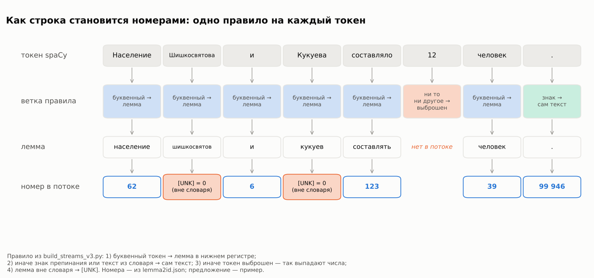
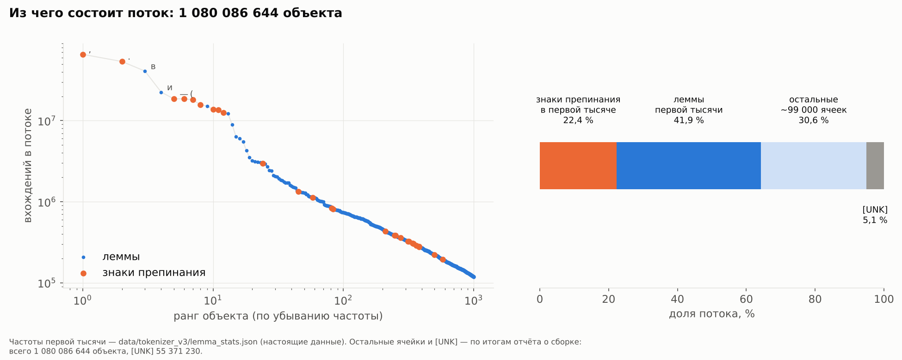
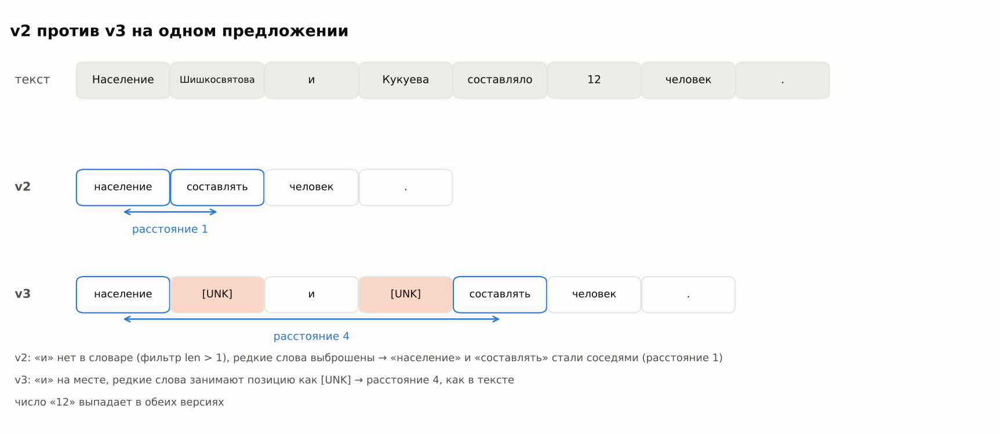

# ENGRAMS, часть 4. Леммы как объекты: токенизатор v3

*Серия «ENGRAMS: память последовательностей». Часть 4 из 19. Код, словарь, рисунки и все числа — в репозитории, тег `part-04`.*

> ## 🤝 Зачем мы открываем эту работу
>
> **Цель публикации — собрать сообщество: группу людей, которым интересна эта работа и которые хотели бы присоединиться к проекту.** Код, результаты и открытые вопросы выложены для того, чтобы их можно было проверять, развивать и исследовать вместе. Если вам интересно, напишите в группе обсуждения [t.me/sequence_memory](https://t.me/sequence_memory) или откройте issue в этом репозитории. Публикации серии выходят в канале [t.me/E_N_G_R_A_M_S](https://t.me/E_N_G_R_A_M_S), обсуждение идёт в группе @sequence_memory, привязанной к каналу. Так части серии идут в канале подряд и не теряются среди вопросов и комментариев.


В части 3 корпус превратился в 584 фрагмента подготовленного текста. Модель работает не с текстом, а с потоком номеров: каждый номер — это объект, и все матрицы ENGRAMS считают, как часто один объект стоит на заданном расстоянии от другого. Эта часть о том, что считается объектом, как строка превращается в номера, сколько ячеек в словаре и чего стоит его предел.

## 1. Что такое объект

**Объект — это лемма (начальная форма слова) или знак препинания.** «Году», «года» и «годом» — один объект «год». Формы слова склеиваются, поэтому статистика одной леммы собирается со всех её форм, а словарь из 100 000 ячеек покрывает гораздо больше текста, чем такой же словарь форм.

Словарь v3 — **100 005 ячеек**:

| что | сколько | номера |
|---|---|---|
| служебные метки `[UNK]`, `[PAD]`, `[CLS]`, `[SEP]`, `[MASK]` | 5 | 0–4 |
| леммы, по убыванию частоты | 99 941 | 5–99 945 |
| знаки препинания и математические знаки | 59 | 99 946–100 004 |

Номер леммы — её место по частоте: «в» — 5, «и» — 6, «год» — 7, «население» — 62. `[UNK]` (неизвестный объект) — 0. Знаки идут в конце в фиксированном порядке: «.» — 99 946, «,» — 99 950.

Словарь — файл `data/tokenizer_v3/lemma2id.json` («лемма → номер»). Он единственный источник истины: обратное отображение «номер → лемма» строится из него, а не хранится отдельно. Почему так — в разделе 9.

## 2. Как строка становится номерами

Каждая подготовленная строка (часть 3) проходит через морфологический анализатор spaCy с моделью `ru_core_news_lg`. Дальше на каждый токен действует одно правило из четырёх шагов, дословно из `build_streams_v3.py`:

```python
if token.is_alpha:                                   # 1. буквенный токен
    lemma = token.lemma_.lower().strip()             #    → лемма в нижнем регистре
elif token.is_punct or token.text in lemma2id:       # 2. знак или текст из словаря
    lemma = token.text.strip()                       #    → сам текст
else:
    continue                                         # 3. иначе токен выброшен
tok_id = lemma2id.get(lemma, UNK_ID)                 # 4. вне словаря → [UNK] = 0
```



На рисунке — предложение-пример. Номера взяты из настоящего словаря, леммы показаны такими, какими их даёт правило; это иллюстрация, а не вывод программы.

Порядок проверок важен. Если сначала проверить «текст есть в словаре», а потом «буквенный», то слово, чья форма совпала с какой-то леммой словаря, пойдёт в поток формой, а не леммой. Ошибки при этом нет, есть дрейф координат — раздел 9.

Знак препинания, которого нет среди 59, по шагу 2 тоже станет `[UNK]`: он проходит как знак, но в словаре не найден.

## 3. Почему числа выпадают из потока

«1945», «12», «3,14» — не буквенные токены и не знаки препинания, а в словаре чисел нет. Значит, по шагу 3 они **выбрасываются целиком, без `[UNK]`**. В потоке их нет, и соседи числа становятся соседями друг друга.

Это расходится с главным правилом v3 — сохранять расстояния (раздел 6). Для редких слов оно соблюдено, для чисел нет. Шаг 3 перешёл из v2 без изменений: при сборке v3 меняли только фильтр длины и обработку лемм вне словаря.

**Сколько чисел выпало из потока v3, мы не мерили.** Числа, даты и меры — одна из причин, по которым делалась следующая версия токенизатора. О ней — в части 18.

## 4. Словарь: сколько слов и какой ценой

Словарь собран за один проход по всем 584 фрагментам (`lemma_tokenizer_v3.py`, 6 процессов, 7 ч 22 мин):

| шаг | лемм |
|---|---|
| уникальных лемм в корпусе | 7 339 690 |
| встречаются хотя бы 5 раз (`min_freq = 5`) | 1 724 587 |
| взято в словарь (самые частые) | 99 941 + 59 знаков |

Всё, что не поместилось, в потоке становится `[UNK]`: **55 371 230 позиций, 5,13 % потока**. Это цена словаря в 100 000 ячеек.



Распределение крутое. Тысяча самых частых объектов — это **64,3 %** потока, первые десять — 26,2 %. На первых двух местах — запятая (65,8 млн) и точка (53,6 млн). Знаки препинания внутри первой тысячи дают 22,4 % потока, то есть почти каждый четвёртый объект — знак. Поэтому знаки здесь полноправные объекты: их тоже приходится предсказывать (часть 2).

Почему не взять словарь больше? Хвост из 1,7 млн лемм, встретившихся хотя бы 5 раз, — это в основном имена собственные. Что в нём лежит и почему его не закрыть ростом словаря — тема части 18.

## 5. Служебные слова — не мусор

В предыдущей версии словаря (v2) стоял фильтр `len(token.text) > 1`: в словарь шли только буквенные токены длиннее одного символа. Задумывался он против мусора, а выбросил «и», «а», «с», «о», «у», «я». В потоке v2 их не было, в матрицах тоже. Вся линия исследований о связках и операторах («и», «а», «или») была непроверяема.

В v3 фильтр снят, а при сборке словаря стоит жёсткая проверка: контрольный список служебных слов должен быть в словаре полностью, иначе словарь не сохраняется и сборка падает. Результат: союзы 19 из 19, предлоги 34 из 34, частицы 13 из 13, местоимения 15 из 15.

| лемма | номер | вхождений |
|---|---|---|
| и | 6 | 22 496 469 |
| с | 9 | 8 971 129 |
| а | 22 | 2 411 339 |
| о | 28 | 1 827 753 |
| у | 50 | 1 144 037 |
| я | 403 | 252 110 |

Цена — 136 одиночных букв в словаре (инициалы, латиница). Лучше лишние буквы, чем потерянное «и».

Служебные слова несут структуру, и это видно прямо в счётчиках. В матрице соседства на расстоянии 1 у «а» 44 233 разных правых соседей и только 7 975 разных левых. «А» почти всегда открывает отрезок после запятой, поэтому слева от неё в том же отрезке почти никого нет. Асимметрия строки и столбца — это синтаксическая роль слова, записанная числами (об отрезках — часть 6).

## 6. `[UNK]` занимает место, но не голосует



В v2 лемма вне словаря выбрасывалась. Тогда два слова, между которыми стояло редкое имя, становились соседями, и расстояния между объектами — основа всех матриц — врали. В v3 такая лемма заменяется на `[UNK]` и занимает свою позицию. Расстояния в потоке совпадают с текстом (кроме чисел, раздел 3).

Но у `[UNK]` есть цена: это самый частый «объект» после запятой и точки, и он ничего не значит. Пришлось сделать две вещи.

1. **Маска в выдаче.** `[UNK]` убран из кандидатов ответа. Без маски он занимал первые места и выталкивал верный ответ. На leak (284 задачи, фрагмент 1) маска дала +3,2 пункта у лучшей головы (71,48 → 74,65 % на первом месте) и +2,8 у пула кандидатов (38,03 → 40,85 %). С тех пор маска — обязательная настройка всех замеров.
2. **Запрет совпадения в поиске по n-граммам.** Поиск продолжений ищет в корпусе места, где совпадает хвост контекста. Без запрета любой `[UNK]` совпадал бы с любым `[UNK]`, и глубина совпадения — маркер уверенности (часть 15) — была бы ложной. Поэтому позиция с `[UNK]` никогда не считается совпадением, `[UNK]` не бывает продолжением, а задачи с целью `[UNK]` исключены из набора (часть 2).

Строка и столбец `[UNK]` в самих матрицах остались: 55 млн вхождений участвуют в подсчёте. Обнулять ли их, не проверено.

## 7. Три синхронных потока

Один проход spaCy по фрагменту пишет три файла с одними координатами:

| поток | тип | что в нём |
|---|---|---|
| леммы | int32 | номер объекта |
| морфология | uint16 | признаки формы: род, число, падеж, время, лицо, вид, часть речи |
| предложения | список пар | границы предложений (razdel) в координатах потока |

Лемматизация склеивает формы, и в потоке лемм «нового дома» и «новым домам» неотличимы. Форма слова не теряется: её признаки лежат в потоке морфологии под тем же номером позиции. Чемпион ENGRAMS (часть 17) работает только с потоком лемм; поток морфологии собран на будущее (согласование, «морфология на выходе» из части 1) и в этой серии пока не используется.

Длины потоков обязаны совпадать: при расхождении фрагмент не сохраняется и сборка падает. Итог: 584 из 584 фрагментов синхронны, 1 080 086 644 объекта, 85 527 922 предложения, 7 ч 50 мин на 6 процессах.

## 8. Что считается попаданием

Все числа серии — это **точное совпадение леммы**: модель предсказала «город», в тексте «город». Формы склеены лемматизацией, а синонимы нет: «город» вместо «посёлок» — промах, даже если фраза осталась верной.

Отсюда два вывода, которые важно не перепутать.

- **98 % в режиме leak** проверяет только одно: память не теряет записанное (часть 2).
- **24–33 % в режиме gen** — это нижняя граница, а не мера понимания. Остальные ответы не обязательно подобраны не по смыслу: модель могла поставить другое слово, и фраза осталась бы верной.

Чтобы это оценить, нужно либо читать тексты человеку, либо иметь механизм оценки по смыслу, а надёжного такого механизма пока нет. Мы пробовали автоматически проверять, не стоит ли на месте ответа синоним исходного слова по тезаурусу RuWordNet:

| замер | результат | условия |
|---|---|---|
| Синоним, гипоним или гипероним цели засчитывается как попадание | +0,7…1,1 пункта на первом месте, +1,7…2,4 в первой десятке (например, 13,87 → 14,53 % и 37,20 → 38,93 %) | ранняя модель, не чемпион; фрагмент 0, 750 задач, контекст 30 |
| Разбор промахов: кем оказался неверный ответ | по тезаурусу не связан с целью 74,1 %, смешанные случаи 25,7 %, синоним 0,2 % | та же постановка |
| Места `[UNK]`: те же 2 и более левых и правых соседа встречаются в корпусе с разными словами в середине | в 117 из 200 мест (58,5 %) подходит больше одного слова | v3, поиск по n-граммам, глубина ≥ 2 |

Сам подход верный, но считать такую проверку достоверной трудно. Синоним может не стоять на месте заменяемого слова, потому что употребляется иначе и тянет за собой другие смысловые замены. К тому же RuWordNet покрывает только 32 % словаря v3. Поэтому эти числа — оценка, а не мера смысла, и надёжная оценка по смыслу — открытая задача.

Ещё один вопрос из обсуждения — контекст, который был 100 объектов назад. Окно в 15–30 объектов отвечает за связную мысль, а за дальний контекст отвечает другой механизм — облако сцены, то есть накопленный контекст статьи, который сужает выбор. Его замер будет в отдельной части, с числами, какими бы они ни оказались.

## 9. Что уже проверено

### Что сработало

| что проверяли | результат | условия | подробно |
|---|---|---|---|
| Маска `[UNK]` в выдаче | +3,2 пункта на первом месте (71,48 → 74,65 %), пул +2,8 (38,03 → 40,85 %) | leak, фрагмент 1, 284 задачи | раздел 6 |
| Снятие фильтра `len > 1` | «и, с, а, о, у, я» вернулись; контрольный список 81 из 81 | проверка состава, не точность | раздел 5 |
| `[UNK]` вместо выбрасывания | расстояния в потоке совпадают с текстом (кроме чисел) | влияние на точность отдельно не мерилось: v2 и v3 несравнимы, у них разные словари и номера | раздел 6 |
| Модель `ru_core_news_lg` вместо `sm` | `sm` разбирает «чём-то» как два существительных (с родом и падежом у частицы), `lg` — как местоимение | один пример, не замер | — |
| Пересборка потоков фрагмента 2 в чистом окружении по опубликованному коду и словарю | все три потока совпали с исходными байт в байт: 1 815 018 объектов, морфология и границы предложений | 27.11.2026, spaCy 3.8.18, модель `ru_core_news_lg` 3.8.0, 1 процесс, 5 мин; другие фрагменты не пересобирались | раздел 10 |
| Запрет совпадения `[UNK]` в поиске по n-граммам | без него любой `[UNK]` совпадал бы с любым и давал ложную глубину | необходимость по построению; цена не измерена | раздел 6 |

### Что не сработало: ошибки

| ошибка | что случилось | что из неё выросло |
|---|---|---|
| Фильтр `len(token.text) > 1` в v2 | из словаря, потока и матриц выпали «и, а, с, о, у, я»; линия исследований о связках и операторах была непроверяема | фильтр снят; словарь не сохраняется, пока не пройдена проверка служебных слов |
| Лемма вне словаря выбрасывалась в v2 | слова по обе стороны редкого имени становились соседями, расстояния врали | `[UNK]` занимает позицию |
| Токенизатор переписан с нуля, проверки в обратном порядке (сначала «текст в словаре», потом «буквенный») | неверная лемма у слов, чья форма совпала с леммой словаря; дрейф около 20 объектов на фрагмент, 8 403 на 584; ночь счёта и час отладки | правило: эталон разметки не переписывать, а переиспользовать дословно |
| Морфология в знаковом `int16` | часть речи лежит в битах 13–15, и код запятой (57 344) не помещался в 32 767 | `uint16`, раскладка битов прежняя |
| Рассинхрон двух файлов словаря (ещё до v2) | `lemma2id['компьютер'] = 2476`, а `id2lemma[2476] = 'наблюдать'`: счёт шёл верно, а все расшифровки лемм в отчётах были случайными | один файл — источник истины (раздел 1) |
| Известный дефект модели `lg` | «ней» лемматизируется как «ней», а не «она» | оставлен как есть и записан в `lemma_stats.json` |

### Что не измерено

- **Сколько чисел выпало из потока** и как это влияет на предсказание (раздел 3).
- **Строка и столбец `[UNK]` в матрицах.** Маска на выходе проверена, обнуление при подсчёте — нет.
- **Цена запрета `[UNK]` в n-граммах**: насколько раздувалась бы глубина без него.
- **Оптимальный размер словаря.** 5,13 % `[UNK]` — цена 100 000 ячеек; из чего состоит хвост — часть 18.
- **Выбор лемматизатора.** spaCy сравнивали с другими лемматизаторами позже, на рецепте следующей версии (часть 18). Для v3 сравнения нет.
- **Надёжная оценка по смыслу** вместо точного совпадения леммы (раздел 8).

Это хорошие задачи для тех, кто хочет присоединиться.

## 10. Как воспроизвести

Всё запускается из корня клона, пути по умолчанию — папки репозитория (список путей и заглушек — [`docs/DATA_PATHS.md`](../../DATA_PATHS.md)).

```bash
pip install -r requirements.txt
python -m spacy download ru_core_news_lg
python scripts/smoke_test.py      # весь конвейер на маленьком примере за минуту
```

`smoke_test.py` разбирает пример дампа скриптом части 3, строит три потока с опубликованным словарём, переводит поток обратно в слова и проверяет, что на трёх статьях словарь не сохраняется: служебных слов там не хватает, срабатывает проверка из раздела 5. На примере видно и то, что числа выпадают: «В 1945 году на этой реке…» становится «в год на этот река…».

Код — `scripts/part04/`:

| файл | что делает | вход → выход по умолчанию |
|---|---|---|
| `lemma_tokenizer_v3.py` | словарь лемм с проверкой служебных слов (≈ 7,5 ч на 6 процессах) | `data/corpus/chunks_584/` → `data/work/tokenizer_v3/` |
| `build_streams_v3.py` | один проход spaCy → три синхронных потока (≈ 8 ч) | `data/corpus/chunks_584/` + `data/tokenizer_v3/lemma2id.json` → `data/streams_v3/` |
| `common_v3.py` | упаковка морфологии в uint16 | — |
| `build_top_lemmas_v3.py` | 1000 самых частых объектов без `[UNK]` — фильтр цели для набора задач (часть 2) | `data/streams_v3/lemmas_npy_v3/` → `data/work/top_lemmas_1000.json` |

Пересобранный словарь пишется в `data/work/`, а не поверх опубликованного: его можно сравнить с `data/tokenizer_v3/lemma2id.json`. Готовые потоки всех 584 фрагментов скачиваются командой `python scripts/fetch_data.py --what streams`.

Словарь — `data/tokenizer_v3/lemma2id.json`, рядом `lemma_stats.json` (модель, параметры, 1000 самых частых лемм с частотами). С ним номера из набора задач части 2 переводятся в слова:

```python
import json
l2i = json.load(open('data/tokenizer_v3/lemma2id.json', encoding='utf-8'))
i2l = {i: w for w, i in l2i.items()}          # обратное отображение строится, а не хранится
print(i2l[7], i2l[62], i2l[99950])             # год население ,
```

## 11. Что дальше

Часть 5 — почему леммы, а не BPE и не слоги: что показали замеры с другими единицами.

---

*Числа — из отчёта о сборке токенизатора v3 и рабочих отчётов проекта. Рис. 2 — настоящие данные словаря, рис. 1 и 3 — схемы на примере предложения. Рисунки пересобираются скриптом `docs/figures/make_part04_figures.py`. Код — PolyForm Noncommercial 1.0.0: свободно для исследований, обучения и некоммерческих целей; коммерческое использование — по лицензии автора (см. `COMMERCIAL.md`). Словарь производен от текста Википедии — CC BY-SA 4.0. Публикации: канал [t.me/E_N_G_R_A_M_S](https://t.me/E_N_G_R_A_M_S); обсуждение: группа [t.me/sequence_memory](https://t.me/sequence_memory).*
